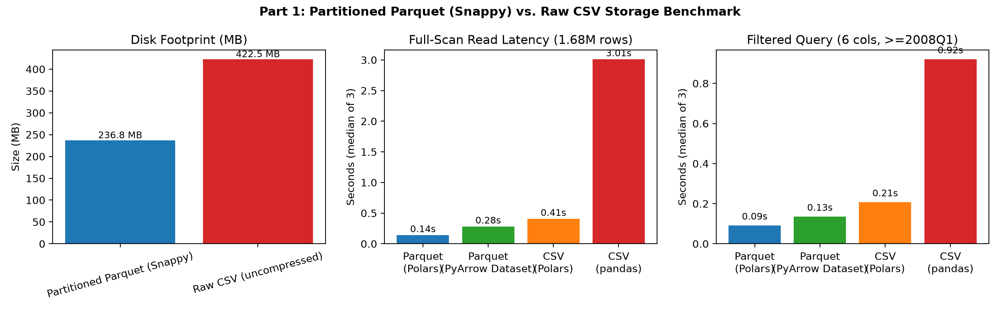
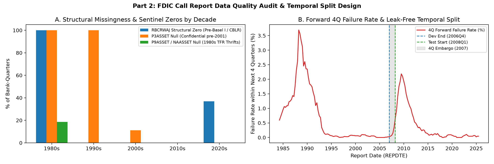
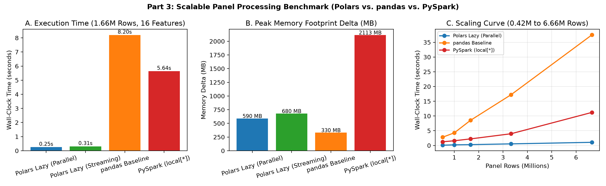
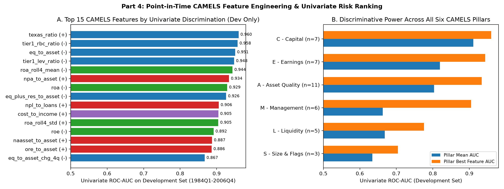
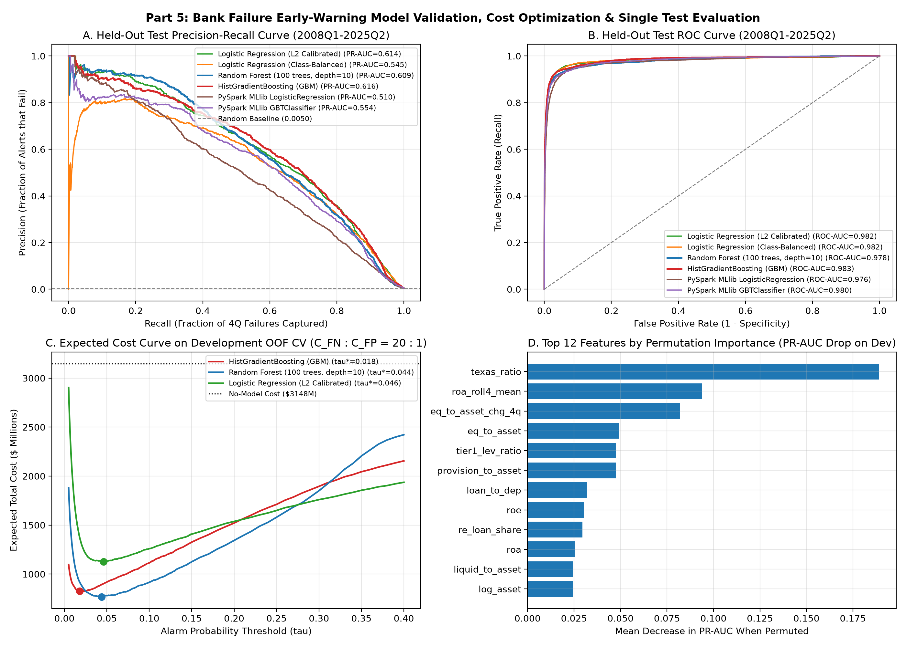

# NATIONAL ECONOMICS UNIVERSITY · BFT65B – BIG DATA ANALYTICS IN FINANCE
## Final Examination – Individual Research Report
# A Big-Data Pipeline for Bank Failure Early Warning

---

### First-Page Submission Metadata (Section 4.1 Compliance)

| Field | Details |
|---|---|
| **Author Name** | **NGUYEN MINH HIEU** |
| **Student ID** | **11230961** |
| **Course** | BFT65B – Big Data Analytics in Finance (National Economics University) |
| **GitHub Repository URL** | `[INSERT_PUBLIC_GITHUB_URL_HERE]` *(Public from deadline until grades are released)* |
| **Data Download Method & Date** | Downloaded on **`2026-11-19`** via the public **FDIC BankFind Suite REST API** (`https://api.fdic.gov/banks`) using a resumable, quarter-partitioned Python ingestion script (`fdic_download_starter.py`) with automated manifest verification (`manifest_financials.json`). |
| **Raw Table Row Counts** | **`Financials`:** `1,682,738` bank-quarter rows across `170` quarters (`1984Q1–2026Q2`), `24,064` distinct banks (`CERT`), `3` key fields + `30` Call Report financial fields (`0` duplicate `(CERT, REPDTE)` pairs; `0` incomplete quarters).<br>**`Institutions`:** `27,835` rows (`9` structural and exit-classification fields).<br>**`Failures`:** `4,117` historical failure/assistance events (`1934–2026`, `9` fields; `3,275` events on or after `1984-01-01` across `3,240` unique `CERT`s). |
| **Clean Labeled Modeling Panel ($\le$ 2025Q2)** | **`1,664,114` bank-quarter rows** across `166` quarters (`1984Q1–2025Q2`) after excluding `1,095` post-failure conservatorship filings (`rep_dt >= fail_dt` for outright failures) and `17,529` right-censored observations in `2025Q3–2026Q2`. |
| **Development Period (`split == 'dev'`)** | **`1984Q1–2006Q4`** (`19840331` to `20061231`, `92` quarters): **`1,193,914` clean bank-quarters**, `23,624` distinct banks, **`10,251` positive failure labels ($y_{i,q}=1$, `0.8586%` base rate)** corresponding to **`2,658` distinct failing banks (`CERT`)**. |
| **Embargo / Purge Gap (`split == 'embargo'`)** | **`2007Q1–2007Q4`** (`20070331` to `20071231`, `4` quarters): **`34,754` clean bank-quarters**, `8,892` distinct banks, `53` positive labels (`0.1525%`), `32` distinct failing banks. Enforces a strict 4-quarter purge buffer so no 4-quarter forward label window in Development overlaps with the Test period. |
| **Held-Out Test Period (`split == 'test'`)** | **`2008Q1–2025Q2`** (`20080331` to `20250630`, `70` quarters): **`435,446` clean bank-quarters**, `8,798` distinct banks, **`2,181` positive failure labels ($y_{i,q}=1$, `0.5009%` base rate)** corresponding to **`558` distinct failing banks (`CERT`)** (exceeding the $\ge 50$ failures requirement by more than $11\times$). Evaluated **once** at the end of the pipeline. |

---

## 1. Context & Problem Formulation

Central bank banking supervision departments face a core data-engineering and risk-analytics challenge: converting decades of quarterly regulatory balance-sheet and income-statement filings into an early-warning system (EWS) that ranks insured institutions by their probability of failure over the upcoming year. At the **State Bank of Vietnam (SBV)**, banking supervision (*Cơ quan Thanh tra, Giám sát Ngân hàng*) requires an automated, auditable, and strictly leak-free pipeline capable of ingesting regulatory filings, reconciling structural reporting changes and institutional exits, computing longitudinal CAMELS risk indicators, and generating cost-calibrated examination alerts under constrained on-site inspection budgets.

Because Vietnamese supervisory Call Report micro-data and resolution records are confidential, we architect and validate the production pipeline on **42 years of public US Federal Deposit Insurance Corporation (FDIC) Call Report data (`1984Q1–2026Q2`)**. This 170-quarter longitudinal panel spans three distinct structural and macroeconomic crisis regimes:
1. **The Savings & Loan (S&L) and Commercial Banking Crisis (`1984–1993`):** Characterized by interest-rate maturity mismatches, commercial real estate (CRE) booms in Texas, California, and New England, FSLIC insolvency, and the passage of FIRREA (1989) and FDICIA (1991).
2. **The Global Financial Crisis (GFC) and Aftermath (`2008–2014`):** Driven by subprime residential mortgages, construction and land development real-estate concentration, and wholesale funding freezes.
3. **The 2023 US Regional Bank Crisis (`2023–2024`):** Triggered by rapid monetary tightening, unrealized duration losses on Held-to-Maturity (HTM) securities portfolios, and rapid digital flight of uninsured deposits (e.g., Silicon Valley Bank, Signature Bank, First Republic Bank).

In accordance with the project brief, this report prioritizes **data-engineering rigor, storage architecture, point-in-time causal correctness, and scalable execution**, answering three core research questions:
- **Q1 (Storage & Scalable Compute):** *How should four decades of bank reports be stored and processed on a laptop, and when would a Spark cluster be needed?*
- **Q2 (Data Quality & Point-in-Time Correctness):** *What quality problems do the raw data contain, and how does the pipeline handle them without look-ahead bias?*
- **Q3 (Honest Early-Warning Validation):** *Can the pipeline's output support an honestly validated early-warning model?*

---

## 2. Data Architecture, Acquisition & Label Design

### 2.1 The Dataset

The raw dataset comprises three relational tables published by the FDIC BankFind Suite API (`https://api.fdic.gov/banks`), linked by the unique FDIC Certificate Number (`CERT`):
1. **`Financials` (`data_raw/fdic/financials/REPDTE=YYYYMMDD.parquet`):** Quarterly Call Report and Thrift Financial Report (TFR) filings at the `(CERT, REPDTE)` grain. All dollar stock and flow quantities are reported in **thousands of USD (`$k`)**, and pre-computed regulatory ratios (`ROA`, `ROE`, `NIMY`, `RBC1AAJ`, `RBCRWAJ`) are reported in **percentage points (`%`)**. Across `170` quarters from `19840331` (`1984Q1`) to `20260630` (`2026Q2`), the panel contains exactly **`1,682,738` bank-quarter observations** across **`24,064` distinct `CERT` institutions** and **`33` columns** (`3` keys + `30` Call Report financial variables).
2. **`Failures` (`data_raw/fdic/failures.parquet`):** Comprehensive historical register of **`4,117` FDIC-insured bank failures and open-bank assistance transactions** from `1934` to `2026` (`9` fields), recording the resolution date (`FAILDATE`), resolution type (`RESTYPE`: `FAILURE` vs. `ASSISTANCE`), pre-failure assets (`QBFASSET`), pre-failure deposits (`QBFDEP`), and estimated direct net loss to the Deposit Insurance Fund (`COST`, in thousands of USD).
3. **`Institutions` (`data_raw/fdic/institutions.parquet`):** Structural directory of **`27,835` FDIC-insured institutions** (`9` fields), documenting charter class (`BKCLASS`: `N`, `SM`, `NM`, `SB`, `SI`, `SA`), headquarters state (`STNAME`), establishment date (`ESTYMD`), active status (`ACTIVE`), structural termination date (`ENDEFYMD`), and the FDIC structural change/exit code (`CHANGEC1`).

### 2.2 Obtaining the Data & Field Justification

Data acquisition is implemented in [`fdic_download_starter.py`](../fdic_download_starter.py) and verified in [`src/01_storage_benchmark.py`](../src/01_storage_benchmark.py). The ingestion procedure pages through the `/financials`, `/failures`, and `/institutions` REST endpoints in batches of `PAGE_SIZE = 10,000` sorted deterministically by `CERT ASC`, using polite rate limiting (`1.0 s` pause between requests) and exponential backoff retry logic (`max_retries = 6`).

To ensure **resumability and atomic completeness**, each quarter $q \in \{\text{19840331}, \dots, \text{20260630}\}$ is written to its own partition file `data_raw/fdic/financials/REPDTE=YYYYMMDD.parquet` and logged immediately in `data_raw/fdic/manifest_financials.json` only if:
$$\text{rows\_downloaded}(q) == \text{api\_meta\_total}(q) \quad \text{and} \quad \text{duplicated}(\texttt{CERT}, \texttt{REPDTE}) == 0.$$
Our automated verification in `src/01_storage_benchmark.py` (`outputs/part1_manifest_summary.csv`) confirms:
- **Quarters verified:** `170 / 170` (`19840331` to `20260630`), `0` incomplete quarters, `0` mismatches between local Parquet row counts and API totals (`1,682,738` rows).
- **Primary key integrity:** `0` duplicate `(CERT, REPDTE)` pairs across all `1,682,738` rows.

#### Table 2.1: Complete Field Dictionary & Supervisory CAMELS Justification (51 Fields Across 3 Tables)

Every field extracted from the FDIC RISView dictionary (`https://api.fdic.gov/banks/docs/risview_properties.yaml`) was selected to provide comprehensive coverage of the six supervisory **CAMELS** pillars (**C**apital Adequacy, **A**sset Quality, **M**anagement Capability, **E**arnings Sufficiency, **L**iquidity Position, and **S**ize/Sensitivity), alongside exact event-history exit reconciliation:

| Table | Field Code | Arrow / Polars Type | Unit | CAMELS Pillar / Role | FDIC Definition & Economic / Supervisory Justification |
|---|---|---|---|---|---|
| `Financials` | `CERT` | `Int64` | ID | Primary Key (Entity) | Unique FDIC Certificate Number identifying each insured depository institution across time. |
| `Financials` | `REPDTE` | `String` | `YYYYMMDD` | Primary Key (Time) | Call Report quarter-end date (`0331`, `0630`, `0930`, `1231`); serves as Hive partition key. |
| `Financials` | `STNAME` | `String` | Name | Geographic Metadata | Headquarters state name; captures regional macroeconomic and real-estate shocks (e.g., Texas in 1988, Georgia/Florida in 2009). |
| `Financials` | `ASSET` | `Float64` | `$k` | **S** – Size / Denominator | Total assets; universal scaling denominator for balance-sheet ratios and log-size (`ln(ASSET)`). |
| `Financials` | `EQ` | `Float64` | `$k` | **C** – Capital Adequacy | Total equity capital; primary common-denominator solvency buffer available continuously across all 170 quarters (`1984–2026`). |
| `Financials` | `RBC1AAJ` | `Float64` | `%` | **C** – Capital Adequacy | Tier 1 Leverage Capital Ratio (Tier 1 capital to average total consolidated assets); core FDICIA Prompt Corrective Action metric. |
| `Financials` | `RBCRWAJ` | `Float64` | `%` | **C** – Capital Adequacy | Tier 1 Risk-Based Capital Ratio (Tier 1 capital to risk-weighted assets); captures risk-adjusted capital adequacy post-Basel I (1990+). |
| `Financials` | `LNLSGR` | `Float64` | `$k` | **A / M** – Loan Book Scale | Total gross loans and lease financing receivables; denominator for credit concentration and delinquency ratios. |
| `Financials` | `LNLSNET` | `Float64` | `$k` | **A** – Asset Quality | Net loans and leases (`LNLSGR` minus allowance for loan losses and unearned income). |
| `Financials` | `LNATRES` | `Float64` | `$k` | **A / C** – Loss Reserves | Allowance for loan and lease losses (ALLL / ACL); buffer absorbed before credit losses impair book equity. |
| `Financials` | `NCLNLS` | `Float64` | `$k` | **A** – Asset Quality | Total noncurrent loans and leases (past due $\ge 90$ days plus nonaccrual loans); core numerator of NPL ratio and Texas Ratio. |
| `Financials` | `NAASSET` | `Float64` | `$k` | **A** – Asset Quality | Total nonaccrual assets; severest tier of impaired assets no longer accruing interest income. |
| `Financials` | `P9ASSET` | `Float64` | `$k` | **A** – Asset Quality | Assets past due $\ge 90$ days and still accruing interest; late-stage delinquency pipeline prior to nonaccrual status. |
| `Financials` | `P3ASSET` | `Float64` | `$k` | **A** – Asset Quality | Assets past due 30–89 days and still accruing; early-stage credit migration indicator (public from 2001Q1 onward). |
| `Financials` | `ORE` | `Float64` | `$k` | **A** – Asset Quality | Other Real Estate Owned (foreclosed properties acquired through default); illiquid non-earning distressed assets. |
| `Financials` | `NTLNLS` | `Float64` | `$k` | **A** – Asset Quality | Net charge-offs of loans and leases (gross charge-offs minus recoveries); realized credit destruction. |
| `Financials` | `ELNATR` | `Float64` | `$k` | **A / E** – Provisioning | Provision for loan and lease losses (income-statement expense building `LNATRES`); spikes when management recognizes credit deterioration. |
| `Financials` | `LNRE` | `Float64` | `$k` | **M** – Concentration | Loans secured by real estate; primary driver of losses in both the 1980s S&L crisis and 2008–2012 GFC (Cole & White, 2012). |
| `Financials` | `LNCI` | `Float64` | `$k` | **M** – Concentration | Commercial and industrial (C&I) loans; corporate credit exposure sensitive to business-cycle recessions. |
| `Financials` | `LNCON` | `Float64` | `$k` | **M** – Concentration | Loans to individuals for household, family, and personal expenditures (consumer credit cards, auto loans). |
| `Financials` | `NONIX` | `Float64` | `$k` | **M / E** – Efficiency | Total non-interest expense (salaries, premises, overhead, OREO maintenance costs); measures operational cost control. |
| `Financials` | `NETINC` | `Float64` | `$k` | **E** – Earnings | Net income (cumulative year-to-date profit/loss); determines internal capital generation vs. equity depletion. |
| `Financials` | `INTINC` | `Float64` | `$k` | **E** – Earnings | Total interest and fee income on loans and securities; gross revenue from earning assets. |
| `Financials` | `EINTEXP` | `Float64` | `$k` | **E / L** – Funding Cost | Total interest expense on deposits and borrowings; rises sharply when distressed banks pay premium rates to retain funding. |
| `Financials` | `NONII` | `Float64` | `$k` | **E** – Earnings | Total non-interest income (service charges, trading, fiduciary fees); revenue diversification indicator. |
| `Financials` | `ROA` | `Float64` | `%` | **E** – Earnings | Return on Assets (annualized net income as % of average assets); headline supervisory profitability benchmark. |
| `Financials` | `ROE` | `Float64` | `%` | **E** – Earnings | Return on Equity (annualized net income as % of average total equity). |
| `Financials` | `NIMY` | `Float64` | `%` | **E** – Earnings | Net Interest Margin (annualized net interest income as % of average earning assets); core intermediation spread. |
| `Financials` | `DEP` | `Float64` | `$k` | **L** – Liquidity / Funding | Total deposits; primary liability funding base and denominator for loan-to-deposit and brokered-deposit shares. |
| `Financials` | `DEPDOM` | `Float64` | `$k` | **L** – Liquidity / Funding | Deposits held in domestic offices (`DEPDOM <= DEP`). |
| `Financials` | `BRO` | `Float64` | `$k` | **L** – Liquidity / Funding | Total brokered deposits; wholesale, rate-sensitive "hot money" heavily used by distressed banks to mask core deposit flight. |
| `Financials` | `CHBAL` | `Float64` | `$k` | **L** – Liquidity Buffer | Cash and balances due from depository institutions (vault cash, Fed reserves, correspondent balances); immediate liquidity buffer. |
| `Financials` | `SC` | `Float64` | `$k` | **L** – Liquidity Buffer | Total investment securities; secondary liquidity reserve and collateral pool (`(CHBAL + SC) / ASSET`). |
| `Failures` | `CERT`, `FAILDATE`, `FAILYR` | `Int64`, `String` | Date | Target Construction | Identifies failed bank and exact calendar date of FDIC receivership/assistance (`FAILDATE`) to construct $y_{i,q} \in (q, q+4]$. |
| `Failures` | `RESTYPE` | `String` | Category | Target / Cleaning | Resolution category (`FAILURE`: 3,524 rows vs. open-bank `ASSISTANCE`: 593 rows); distinguishes terminal closure from open-bank aid. |
| `Failures` | `COST`, `QBFASSET`, `QBFDEP` | `Float64` | `$k` | Cost Thresholding | Estimated net loss to the Deposit Insurance Fund (`COST`) and pre-failure size; used on Development data to calibrate $C_{\text{FN}}$. |
| `Failures` | `NAME`, `CITYST` | `String` | Text | Audit Metadata | Institution name and city/state at failure for case-study verification (e.g., SVB, First City Texas). |
| `Institutions` | `CERT`, `NAME`, `STNAME`, `BKCLASS` | `Int64`, `String` | Category | Entity Metadata | Charter class (`N`, `SM`, `NM`, `SB`, `SA`) and state directory across `27,835` institutions. |
| `Institutions` | `ACTIVE`, `CHANGEC1`, `ENDEFYMD`, `ESTYMD`, `INSDATE` | `Int64`, `Float64`, `String` | Code / Date | Exit Reconciliation | `ACTIVE` status and `CHANGEC1` exit reason code (e.g., `223` unassisted merger, `211` absorption, `221` consolidation) verify non-failure exits ($y_{i,q}=0$). |

---

### 2.3 Label Definition & Temporal Split Design

#### Exact Forward-Looking 4-Quarter Failure Label
For every active bank $i$ (`CERT`) filing a Call Report at quarter-end date $q$ (`rep_dt`), we define the binary early-warning target variable $y_{i,q} \in \{0, 1\}$ over the forward 4-quarter horizon $(q, q + 4\text{ quarters}]$ (where $q + 4\text{ quarters}$ equals the calendar date 1 year after $q$, `rep_dt_plus_4q = rep_dt + 1 year`):

$$y_{i,q} = \mathbb{I}\Big\{\exists \text{ failure event for bank } i \text{ in } \texttt{failures.parquet} \text{ with } \text{rep\_dt}_q < \texttt{FAILDATE} \le \text{rep\_dt}_{q + 4\text{ quarters}}\Big\}.$$

Three critical domain and econometric rules govern this label construction (`src/02_data_quality_and_panel.py`):
1. **Mergers and Voluntary Closures Are Not Failures ($y_{i,q} = 0$):** In the US banking industry, `16,345` distinct banks (`67.9%` of all `24,064` panel institutions) exited the Call Report panel via unassisted mergers, holding-company consolidations, or voluntary liquidations (`CHANGEC1` codes `223`, `211`, `221`, `217`, `240`, `213`, etc. in `institutions.parquet`, without a matching post-1984 event in `failures.parquet`). These non-failure exits receive $y_{i,q} = 0$ up through their final reporting quarter (Wheelock & Wilson, 2000).
2. **Exclusion of Post-Failure Conservatorship Filings (`1,095` rows):** Our event-history cross-check revealed `35` banks with multiple post-1984 events in `failures.parquet` (e.g., open-bank `ASSISTANCE` in 1988 followed by outright `FAILURE` in 1992) and **`1,095` Call Report rows filed on or after an institution's outright failure date** ($\text{rep\_dt}_q \ge \texttt{FAILDATE}$ with $\texttt{RESTYPE} == \text{'FAILURE'}$). These occurred predominantly between 1985 and 1992 when insolvent Savings & Loans entered FSLIC or Resolution Trust Corporation (RTC) government conservatorship (`FAILDATE`) but continued submitting Call Reports during wind-down. Keeping post-failure conservatorship quarters in the active panel would mislabel already-failed institutions as "non-failing in the next 4 quarters" ($y_{i,q}=0$). We therefore remove all `1,095` rows where $\text{rep\_dt}_q \ge \texttt{FAILDATE}_{\text{FAILURE}}$.
3. **Exclusion of Right-Censored Quarters (`2025Q3–2026Q2`, `17,529` rows):** Because the raw panel ends at `2026Q2` (`2026-06-30`), any Call Report filed after `2025Q2` (`2025-06-30`) has an incomplete 4-quarter forward observation window extending into `2026Q3–2027Q2`. In strict adherence to Section 2.3, all modeling is restricted to `REPDTE <= '20250630'` (`166` quarters, `1,664,114` clean bank-quarters).

#### Leak-Free Chronological Split with 4-Quarter Embargo Gap
Because $y_{i,q}$ depends on failure realizations up to 4 quarters into the future $(q, q+4]$, a naive split that ends training at quarter $T$ and starts testing at $T+1$ leaks future test-period failure outcomes from quarters $(T+1, T+4]$ into the training labels of quarters $(T-3, T]$. To eliminate label overlap completely, we partition the `1,664,114`-row clean panel into three disjoint chronological regimes (`outputs/part2_split_summary.csv`):

#### Table 2.2: Chronological Split, Embargo Buffer, and Failure Label Distribution

| Split Regime | Start Quarter | End Quarter | Quarters | Clean Bank-Quarters | Distinct Banks (`CERT`) | Positive Labels ($y_{i,q}=1$) | Positive Rate (%) | Distinct Failing Banks (`CERT`) | Economic & Crisis Regimes Covered |
|---|---|---|---:|---:|---:|---:|---:|---:|---|
| **Development (`dev`)** | `1984Q1` (`19840331`) | `2006Q4` (`20061231`) | 92 | **1,193,914** | 23,624 | **10,251** | **0.8586%** | **2,658** | S&L Crisis, 1980s Texas/ Regional Banking Crisis, FIRREA/FDICIA, 1990s–2006 Consolidation |
| **Embargo Gap (`embargo`)** | `2007Q1` (`20070331`) | `2007Q4` (`20071231`) | 4 | **34,754** | 8,892 | **53** | **0.1525%** | **32** | 4-Quarter Purge Buffer (`2006Q4` label window ends at `2007Q4`, strictly before Test starts in `2008Q1`) |
| **Held-Out Test (`test`)** | `2008Q1` (`20080331`) | `2025Q2` (`20250630`) | 70 | **435,446** | 8,798 | **2,181** | **0.5009%** | **558** | 2008–2014 Global Financial Crisis (`2,052` $y=1$ rows), 2015–2022 Calm (`107`), 2023 Regional Bank Crisis (`22`) |
| *Right-Censored (Dropped)* | `2025Q3` (`20250930`) | `2026Q2` (`20260630`) | 4 | *17,529* | *4,461* | *11* | *0.0628%* | *4* | Excluded from modeling because 4Q forward failure window extends past `2026Q2` |

---

## 3. Technical Pipeline & Empirical Results (Parts 1–5)

### Part 1 — Acquisition & Storage Architecture [15 pts]

#### 1.1 Storage Layout Design & Cross-Partition Schema Standardization
The `Financials` table (`1,682,738` rows $\times$ `33` columns) is stored as **170 quarter-partitioned Apache Parquet files** (`data_raw/fdic/financials/REPDTE=YYYYMMDD.parquet`) compressed with the **Snappy** codec. During initial inspection (`src/01_storage_benchmark.py`), we identified an important real-world storage subtle point caused by `pandas.DataFrame.to_parquet()`:
- In quarters where an integer-valued Call Report field (such as `LNCON`, consumer loans) contained zero missing values, pandas serialized the column as physical Arrow type `int64`.
- In quarters where at least one bank reported `NaN` for `LNCON`, pandas promoted the column to IEEE-754 `double` (`float64`) because standard NumPy `int64` lacks a `NaN` bit pattern.
- Consequently, scanning all 170 files with a strict reader raises `SchemaError: data type mismatch for column LNCON: incoming: Float64 != target: Int64`.

We resolve this at the storage-reader boundary in `src/01_storage_benchmark.py` and `src/02_data_quality_and_panel.py` by defining an explicit canonical schema (`POLARS_SCHEMA` with `pl.ScanCastOptions(integer_cast="allow-float")` in Polars and `ARROW_SCHEMA` in PyArrow Dataset) that types `CERT` as `Int64`, `REPDTE` and `STNAME` as UTF-8 `String`, and all 30 numeric Call Report variables uniformly as `Float64`.

#### 1.2 Empirical Benchmark: Partitioned Parquet (Snappy) vs. Raw CSV
To quantify the storage and I/O benefits of our layout without committing large data files, `src/01_storage_benchmark.py` exports the full `1,682,738`-row dataset to a temporary uncompressed CSV file (`422.52 MB`), benchmarks three repetitions (reporting the median latency) of both a **Full-Table Scan** (`1,682,738` rows $\times$ `33` columns) and a **Filtered Supervisory Query** (`6` columns: `CERT`, `REPDTE`, `ASSET`, `DEP`, `ROA`, `NCLNLS` for `REPDTE >= '20080331'`, returning `452,975` rows), and deletes the temporary CSV immediately inside a `tempfile.TemporaryDirectory()` context block.

#### Table 3.1: Storage Footprint & Query Latency Benchmark (`outputs/part1_storage_benchmark.csv`)

| Storage Format | Query Engine | Disk Footprint (MB) | Compression Ratio vs. CSV | Full-Scan Latency (s) | Filtered Query Latency (s) | Filtered Speedup vs. pandas CSV | Total Rows | Filtered Rows ($\ge$ 2008Q1) |
|---|---|---:|---:|---:|---:|---:|---:|---:|
| **Partitioned Parquet (Snappy)** | **Polars (`scan_parquet`)** | **236.76 MB** | **1.78x** | **0.1395 s** | **0.0908 s** | **10.13x** | 1,682,738 | 452,975 |
| **Partitioned Parquet (Snappy)** | **PyArrow Dataset** | **236.76 MB** | **1.78x** | **0.2807 s** | **0.1348 s** | **6.82x** | 1,682,738 | 452,975 |
| Raw CSV (Uncompressed) | Polars (`scan_csv`) | 422.52 MB | 1.00x | 0.4062 s | 0.2068 s | 4.45x | 1,682,738 | 452,975 |
| Raw CSV (Uncompressed) | pandas (`read_csv`) | 422.52 MB | 1.00x | 3.0096 s | 0.9201 s | 1.00x | 1,682,738 | 452,975 |



#### 1.3 Engineering Interpretation of Storage Measurements
1. **Columnar Run-Length & Dictionary Encoding + Snappy Compression (`1.78x` Smaller):** Parquet organizes data into columnar chunks using dictionary encoding (highly effective for repeated state strings `STNAME`, quarter dates `REPDTE`, and zero-heavy fields like `BRO` and `ORE`) followed by Snappy LZ77 byte compression, shrinking disk usage from `422.52 MB` to `236.76 MB` while providing near-instant decompression (`>2 GB/s`).
2. **Elimination of Text Parsing Overhead (`21.57x` Full-Scan Speedup):** Reading `1.68M` rows $\times$ `33` columns from CSV in pandas requires `3.0096 s` because single-threaded C tokenizers must scan every byte for newline/comma delimiters and parse ASCII floating-point strings into binary IEEE-754 doubles. Polars reads the binary Arrow column buffers from Parquet across all CPU cores in **`0.1395 s`** (**21.57x** faster than pandas CSV; **2.91x** faster than Polars CSV).
3. **Projection Pushdown & Partition Pruning (`10.13x` Filtered Query Speedup):** When querying `6` of `33` columns for `REPDTE >= '20080331'` (`74` of `170` quarters), CSV readers must still scan all `1,682,738` lines from byte offset 0 because row-oriented text files lack column byte offsets or row-group min/max statistics. Partitioned Parquet skips the 27 unused columns entirely (**projection pushdown**, reading only $6/33 \approx 18\%$ of column chunks) and prunes `96` pre-2008 partition files via metadata (**predicate pushdown**), completing the query in **`0.0908 s`** in Polars vs. `0.9201 s` in pandas CSV (**10.13x** speedup).

---

### Part 2 — Data Quality Audit & Point-in-Time Panel Construction [20 pts]

An automated data quality audit (`src/02_data_quality_and_panel.py`) inspected every column across all `1,682,738` raw bank-quarters, stratifying missingness, zeros, negative entries, accounting identities, reporting gaps, and exit codes across five decades (`1980s`–`2020s`).

#### 2.1 Five Structural Data Quality Problems Discovered in Raw FDIC Data

1. **Regulatory Sentinel Zeros in Risk-Based Capital Ratios (`RBCRWAJ` and `RBC1AAJ`):**
   A naive `null_count()` check on `RBCRWAJ` (Tier 1 Risk-Based Capital Ratio) and `RBC1AAJ` (Tier 1 Leverage Ratio) reports **`0` formal nulls** (`0.0%`). However, inspecting the distribution (`outputs/part2_dq_report.csv` and `outputs/part2_dq_by_decade.csv`) exposes **`468,480` exact zero values (`27.84%` of the panel) in `RBCRWAJ`** and **`79,508` zeros (`4.73%`) in `RBC1AAJ`**, of which **`464,319` (`27.59%`)** and **`75,347` (`4.48%`)** occur in banks with **non-zero book equity (`EQ != 0`)**:
   - **Pre-Basel I Regime (`1984Q1–1989Q4`):** **100.00% of 1980s rows (`419,535` rows)** have `RBCRWAJ == 0.0` because Basel I risk-weighted assets schedules were not introduced on US Call Reports until `1990Q1`. Similarly, **17.97% of 1980s rows** have `RBC1AAJ == 0.0` (FSLIC-insured thrifts filing Thrift Financial Reports prior to FIRREA 1989).
   - **2020 Community Bank Leverage Ratio (CBLR) Regime (`2020Q1–2026Q2`):** The structural zero rate in `RBCRWAJ` jumps from `0.00%` in the 2010s (`0.32%` in 2019) to **`36.92%` across the 2020s (`41.50%` in 2026)**. Under Section 201 of the EGRRCPA (effective `2020Q1`), well-capitalized community banks (`ASSET < $10B`, `RBC1AAJ > 9%`) that opt into the CBLR framework are **exempt from filing risk-weighted capital schedules**, and the FDIC API encodes their unreported `RBCRWAJ` as `0.0`.
   - *Why this is critical:* If `RBCRWAJ == 0.0` is left as a numeric zero, any risk model interprets `36.92%` of healthy 2020s community banks and `100%` of 1980s banks as having `0%` Tier 1 risk-based capital (imminent insolvency!).

2. **Era-Specific Schedule Confidentiality & Thrift Reporting Gaps (`P3ASSET`, `P9ASSET`, `NAASSET`, `NTLNLS`):**
   - `P3ASSET` (assets past due 30–89 days) is **100.00% null from `1984Q1` through `2000Q4`** (`972,047` rows, `57.77%` of the full panel) because early-delinquency Call Report schedules were treated as confidential supervisory data prior to `2001Q1`.
   - `P9ASSET` (`77,750` nulls, `4.62%`), `NAASSET` (`77,749` nulls, `4.62%`), and `NTLNLS` (`79,929` nulls, `4.75%`) are **`18.25%–18.53%` null during the 1980s** (unpopulated on pre-1990 Thrift Financial Reports) and **`0.00%–0.36%` null from 1990 onward**.

3. **Distinguishing Economically Valid Negatives (Insolvency/Losses) from Accounting Errors:**
   Our audit categorizes negative values across all 30 financial fields into two distinct classes (`outputs/part2_dq_report.csv`, `outputs/part2_anomaly_checks.csv`):
   - **Economically Valid Negatives (Must Be Preserved):**
     - `EQ < 0`: **`15,647` rows (`0.93%`)** represent technical book insolvency (minimum `-$4.57B` during the S&L crisis where insolvent thrifts operated under regulatory forbearance before resolution). In the Development set, `41.69%` of failing bank-quarters ($y_{i,q}=1$) have `EQ < 0` vs. only `0.84%` of non-failing bank-quarters!
     - `NETINC < 0` and `ROA < 0`: **`172,749` rows (`10.27%`)** represent net operating losses; `ROE < 0` occurs in **`162,104` rows (`9.63%`)**.
     - `NTLNLS < 0`: **`299,759` rows (`17.81%`)** represent quarters where loan loss recoveries exceeded gross charge-offs (net recoveries).
     - `ELNATR < 0`: **`51,206` rows (`3.04%`)** represent negative loan loss provisions (reserve releases).
   - **Accounting Impossibilities / Data Entry Errors (`989` rows total, `0.059%`):**
     Balance-sheet asset/liability stocks and gross income/expense flows cannot be negative, yet `989` rows exhibit negative values: `ORE < 0` (`645` rows), `NONIX < 0` (`135` rows), `SC < 0` (`96` rows), `LNLSNET < 0` (`51` rows), `LNLSGR < 0` (`33` rows), `EINTEXP < 0` (`31` rows), `INTINC < 0` (`12` rows), `LNATRES < 0` (`9` rows), `LNRE < 0` (`6` rows), `NCLNLS < 0` (`3` rows), `CHBAL < 0` (`2` rows), `LNCI < 0` (`2` rows), and `NAASSET < 0` (`2` rows). Accounting identity checks also found `0` rows with `ASSET <= 0`, `0` rows with `DEPDOM > DEP`, and `16` rows with `LNLSNET > LNLSGR`.

4. **Extreme Ratio Outliers Driven by Near-Zero Denominators:**
   When a distressed bank's book equity `EQ` approaches zero from above or below, `ROE` (`NETINC / EQ`) explodes mechanically, ranging from **`-354,657.8%` to `+301,050.0%`** (while the 1st and 99th percentiles are `-60.14%` and `+38.95%`). Similarly, `ROA` spans `[-761.90%, +860.61%]` and `NIMY` spans `[-4,515.15%, +1,125.00%]`.

5. **Discontinuous Reporting Spells & Institutional Exit Reconciliation:**
   - **Reporting Gaps:** Indexing all 170 quarters sequentially (`q_idx = 0..169`) and checking $\Delta q_{i,t} = \text{q\_idx}_{i,t} - \text{q\_idx}_{i,t-1}$ within each `CERT` reveals **`33` discontinuous reporting gaps ($\Delta q > 1$)** across **`32` distinct banks** (`25` single-quarter gaps where $\Delta q = 2$, and `8` multi-quarter gaps up to $\Delta q = 31$ quarters).
   - **Exit Classification (`outputs/part2_exit_types.csv`):** Reconciling all `24,064` panel `CERT`s against `institutions.parquet` and `failures.parquet` classifies every institution cleanly:

#### Table 3.2: Decade-by-Decade Structural Missingness & Sentinel Zero Audit (`outputs/part2_dq_by_decade.csv`)

| Decade | Total Bank-Quarters | Distinct Banks | `RBCRWAJ` Structural Zero (`%`) | `RBC1AAJ` Structural Zero (`%`) | `P3ASSET` Null (`%`) | `P9ASSET` Null (`%`) | `NAASSET` Null (`%`) | `NTLNLS` Null (`%`) | `ELNATR` Null (`%`) | `BRO` Null (`%`) | `ROE` Null (`%`) |
|---|---:|---:|---:|---:|---:|---:|---:|---:|---:|---:|---:|
| **1980s** (`1984–1989`) | 419,535 | 20,478 | **100.00%** | **17.97%** | **100.00%** | **18.53%** | **18.53%** | **18.25%** | **9.49%** | 3.19% | 2.97% |
| **1990s** (`1990–1999`) | 511,881 | 17,892 | 0.02% | 0.01% | **100.00%** | 0.00% | 0.00% | 0.29% | 0.29% | 0.29% | 0.81% |
| **2000s** (`2000–2009`) | 365,266 | 11,671 | 0.00% | 0.00% | **11.12%** | 0.00% | 0.00% | 0.22% | 0.22% | 0.22% | 0.22% |
| **2010s** (`2010–2019`) | 262,595 | 8,072 | 0.00% | 0.00% | 0.00% | 0.00% | 0.00% | 0.26% | 0.26% | 0.26% | 0.27% |
| **2020s** (`2020–2026Q2`) | 123,461 | 5,250 | **36.92%** | 0.00% | 0.00% | 0.00% | 0.00% | 0.36% | 0.36% | 0.36% | 0.47% |

#### Table 3.3: Institutional Exit Reconciliation Across All 24,064 Panel Banks (`outputs/part2_exit_types.csv`)

| Exit Category | Distinct Banks (`CERT`) | Share of Banks (`%`) | Total Bank-Quarters | Avg. Quarters Reported | Modeling & Label Treatment |
|---|---:|---:|---:|---:|---|
| **Merger / Voluntary Exit (`CHANGEC1` non-failure)** | **16,345** | **67.92%** | 905,689 | 55.4 | Active until exit quarter; labeled $y_{i,q} = 0$ (not a failure). |
| **Active at End of Sample (`2026Q2` / `ACTIVE == 1`)** | **4,309** | **17.91%** | 671,096 | 155.7 | Active throughout; quarters $> \text{2025Q2}$ dropped as right-censored. |
| **Failed / Assisted (in `failures.parquet` $\ge$ 1984)** | **3,218** | **13.37%** | 98,917 | 30.7 | Labeled $y_{i,q} = 1$ in $(q, q+4]$ prior to `FAILDATE`; `1,095` post-failure conservatorship rows removed. |
| **Historical Pre-FIRREA Thrift / Unmatched Exit** | **192** | **0.80%** | 7,036 | 36.6 | Dissolved/merged prior to FIRREA without post-1984 failure entry; labeled $y_{i,q} = 0$. |
| **Total** | **24,064** | **100.00%** | **1,682,738** | **69.9** | **`1,664,114` clean modeling rows (`1984Q1–2025Q2`)** |



#### 2.2 Summary of Point-in-Time Cleaning Rules (Zero Look-Ahead Bias)
Every cleaning operation in `src/02_data_quality_and_panel.py` is strictly causal (point-in-time):
1. **Post-Failure Conservatorship Exclusion:** Drop the `1,095` rows where $\text{rep\_dt}_{i,q} \ge \texttt{FAILDATE}_i$ for an outright failure ($\texttt{RESTYPE} == \text{'FAILURE'}$). This uses only past failure realizations up to quarter $q$.
2. **Point-in-Time Structural Zero Recoding & Validity Flags:** At row $(i, q)$, if $\texttt{RBCRWAJ}_{i,q} == 0$ and $\texttt{EQ}_{i,q} \ne 0$, recode $\texttt{RBCRWAJ}_{i,q} \leftarrow \texttt{null}$ and set binary indicator $\texttt{flag\_rbcrwaj\_struct\_zero}_{i,q} = 1$ (and analogously for `RBC1AAJ` and `flag_p3asset_missing`).
3. **Impossible Negative Stock Clamping:** For the 20 non-negative stock/flow fields (`NON_NEGATIVE_COLS`), set any negative entry ($< 0$) at row $(i, q)$ to `null` and set $\texttt{flag\_impossible\_neg}_{i,q} = 1$. Preserve all negative values in `EQ`, `NETINC`, `ROA`, `ROE`, `NIMY`, `NTLNLS`, `ELNATR`, `NONII`, `RBC1AAJ`, and `RBCRWAJ`, and set $\texttt{flag\_negative\_equity}_{i,q} = \mathbb{I}\{\texttt{EQ}_{i,q} < 0\}$.
4. **Causal 1-Quarter Forward-Fill Within Contiguous Spells:** Segment each bank's timeline into contiguous reporting spells $\texttt{spell\_id}_{i,q} = \sum_{t \le q} \mathbb{I}\{\Delta q_{i,t} > 1\}$ and apply `pl.col(c).forward_fill(limit=1).over(["CERT", "spell_id"])`. Because `spell_id` increments whenever a bank skips a quarter ($\Delta q > 1$) and rows exist only when a bank files a Call Report, forward-filling never crosses a reporting gap, never uses future values (no backward fill), and never extends past a bank's merger or failure exit.
5. **Development-Fitted Ratio Winsorization (`outputs/part2_dev_winsor_bounds.csv`):** The `0.1%` and `99.9%` tail clipping bounds for pre-computed ratios are estimated **exclusively on the Development split (`REPDTE <= '20061231'`)** (`ROA`: `[-23.3238%, +26.8518%]`; `ROE`: `[-647.2500%, +143.7400%]`; `NIMY`: `[-4.7680%, +15.4482%]`; `RBC1AAJ`: `[-12.8093%, +110.7111%]`; `RBCRWAJ`: `[-24.3760%, +530.2044%]`) and applied causally to all splits.

---

### Part 3 — Scalable Processing: Polars vs. pandas vs. PySpark [25 pts]

In [`src/03_scalable_processing.py`](../src/03_scalable_processing.py), we implement 16 core panel transformations on the `1,664,114`-row clean panel (`data_clean/panel_labeled.parquet`) across three engines: **Polars (`LazyFrame` parallel & streaming)**, **pandas (vectorized groupby baseline)**, and **PySpark (`local[*]` DataFrame & Window API)**.

The 16 transformations cover:
- **6 Point-in-Time Financial Ratios:** `eq_to_asset`, `npl_to_loans`, `reserve_to_loans`, `loan_to_dep`, `liquid_to_asset`, `ore_to_asset`.
- **5 Lagged Differences & Growth Rates (within `(CERT, spell_id)` ordered by `q_idx`):** `asset_growth_1q`, `asset_growth_4q`, `eq_to_asset_chg_4q`, `roa_chg_4q`, `npl_to_loans_chg_4q`.
- **4 Trailing 4-Quarter Rolling Window Statistics (`window_size=4, min_samples=4, ddof=1` within `(CERT, spell_id)`):** `roa_roll4_mean`, `roa_roll4_std`, `nim_roll4_mean`, `nim_roll4_std`.
- **1 Cross-Sectional Quarter Demeaning Window (`over("REPDTE")`):** `roa_rel_quarter = ROA_win - mean(ROA_win) over REPDTE`.

#### 3.1 How Polars Executes the Lazy Query Plan (`outputs/part3_polars_explain.txt`)
Inspecting the difference between `lf.explain(optimized=False)` and `lf.explain(optimized=True)` reveals four query-optimizer transformations executed by Polars' Rust engine before any data are materialized:
1. **Columnar Projection Pushdown (`PROJECT 15/57 COLUMNS`):** Although `panel_labeled.parquet` contains `57` columns, the optimizer pushes the required column set down to the `Parquet SCAN` leaf node, reading only `15` columns from disk.
2. **Common Subexpression Elimination (CSE):** Both `npl_to_loans` and `reserve_to_loans` evaluate the predicate `pl.col("LNLSGR") > 0.0`. Polars extracts this repeated predicate into a single temporary boolean column `[(col("LNLSGR") > 0.0).alias("__POLARS_CSER_0x100000008")]` and reuses it across both `when/then/otherwise` branches.
3. **Expression & Window Stage Fusion:** In the unoptimized plan, Stage A (6 ratios) and Stage B (10 window expressions) are separate logical nodes. The optimizer fuses all independent window expressions (`asset_growth_1q`, `asset_growth_4q`, `roa_chg_4q`, `roa_roll4_mean`, `roa_roll4_std`, `nim_roll4_mean`, `nim_roll4_std`, and `roa_rel_quarter`) directly into the first `WITH_COLUMNS` operator alongside the 6 point-in-time ratios, leaving only the two dependent lags (`eq_to_asset_chg_4q`, `npl_to_loans_chg_4q`) in the top `WITH_COLUMNS` stage.
4. **Cache-Aware Parallel Window Evaluation:** Because the table is sorted once by `["CERT", "spell_id", "q_idx"]`, Polars partitions the `(CERT, spell_id)` groups across all CPU threads using work-stealing (Rayon) without hash-shuffling or copying underlying Arrow memory buffers.

#### 3.2 How PySpark Executes the Physical Plan (`outputs/part3_spark_explain.txt`)
Inspecting Spark's Catalyst and Tungsten physical execution plan (`AdaptiveSparkPlan`, full dump in Appendix A.2 and `outputs/part3_spark_explain.txt`) reveals why distributed window execution incurs structural overhead on a single node:
1. **First Hash-Partitioning Shuffle & Sort (`Exchange hashpartitioning(CERT, spell_id, 16)`):** Catalyst consolidates all 15 bank-level window functions (`lag(-1)`, `lag(-4)`, `count`, `avg`, `stddev_samp` over `RowFrame(-3, currentrow)`) into a single physical `Window` operator, but must first execute a full shuffle (`Exchange hashpartitioning(CERT#0L, spell_id#47L, 16)`) and external sort (`Sort [CERT ASC, spell_id ASC, q_idx ASC]`) across the 16 shuffle partitions.
2. **Second Hash-Partitioning Shuffle & Sort (`Exchange hashpartitioning(REPDTE, 16)`):** Because `roa_rel_quarter` partitions by `REPDTE` rather than `(CERT, spell_id)`, Spark cannot evaluate it in the same partition layout; it inserts a **second full shuffle** (`Exchange hashpartitioning(REPDTE#1, 16)`) and sort (`Sort [REPDTE ASC]`) before the final `Window [avg(ROA_win)]` operator.

#### 3.3 Fair Benchmark, Numerical Equivalence & Scaling Curve

To guarantee an apples-to-apples compute benchmark (`outputs/part3_benchmarks.csv`), all engines are timed on the `1,664,114`-row panel (`15` input columns $\rightarrow$ `31` output columns), and memory is tracked via Python `tracemalloc` plus full process-tree Resident Set Size (`psutil`, capturing the Spark JVM child processes).

#### Table 3.4: Engine Performance & Memory Benchmark on Full Panel (`1,664,114` Rows, `outputs/part3_benchmarks.csv`)

| Execution Engine | Panel Rows | Wall-Clock Latency (s) | Speedup vs. pandas | Peak Memory Footprint (MB) | Execution Architecture |
|---|---:|---:|---:|---:|---|
| **Polars Lazy (Parallel)** | 1,664,114 | **0.2536 s** | **32.34x** | **589.6 MB** | Multi-threaded Rust, Arrow buffers, CSE + expression fusion |
| **Polars Lazy (Streaming)** | 1,664,114 | **0.3087 s** | **26.56x** | **679.5 MB** | Out-of-core chunked streaming pipeline from Parquet scan |
| **PySpark (`local[*]`)** | 1,664,114 | **5.6398 s** | **1.45x** | **2,113.4 MB** | Catalyst optimizer + Tungsten JVM heap (`2x Exchange` shuffles) |
| **pandas Baseline** | 1,664,114 | **8.2012 s** | **1.00x** | **330.3 MB** *(delta)* | Single-threaded Python/C `groupby` + `rolling().reset_index()` |

#### Table 3.5: Column-by-Column Numerical Equivalence Check (`outputs/part3_equivalence_check.csv`)

To guarantee that Polars, pandas, and PySpark compute identical mathematical values (specifically enforcing `min_samples=4` in PySpark via `F.when(F.count(c).over(w_roll4) == 4, ...)` and sample standard deviation `ddof=1` via `F.stddev_samp`), we verified all `1,664,114` rows across all 16 engineered columns:

| Engineered Column | Non-Null Count | Null Count | Polars vs. pandas `max_abs_diff` | Polars vs. PySpark `max_abs_diff` | Polars vs. PySpark `mean_abs_diff` | Passes `< 1e-6` Gate |
|---|---:|---:|---:|---:|---:|:---:|
| `eq_to_asset` | 1,660,044 | 4,070 | `0.000000e+00` | `0.000000e+00` | `0.000000e+00` | **True** |
| `npl_to_loans` | 1,642,922 | 21,192 | `0.000000e+00` | `0.000000e+00` | `0.000000e+00` | **True** |
| `reserve_to_loans` | 1,641,381 | 22,733 | `0.000000e+00` | `0.000000e+00` | `0.000000e+00` | **True** |
| `loan_to_dep` | 1,652,181 | 11,933 | `0.000000e+00` | `0.000000e+00` | `0.000000e+00` | **True** |
| `liquid_to_asset` | 1,664,059 | 55 | `0.000000e+00` | `0.000000e+00` | `0.000000e+00` | **True** |
| `ore_to_asset` | 1,659,703 | 4,411 | `0.000000e+00` | `0.000000e+00` | `0.000000e+00` | **True** |
| `asset_growth_1q` | 1,640,027 | 24,087 | `0.000000e+00` | `0.000000e+00` | `0.000000e+00` | **True** |
| `asset_growth_4q` | 1,569,222 | 94,892 | `0.000000e+00` | `0.000000e+00` | `0.000000e+00` | **True** |
| `eq_to_asset_chg_4q` | 1,565,329 | 98,785 | `0.000000e+00` | `0.000000e+00` | `0.000000e+00` | **True** |
| `roa_chg_4q` | 1,569,222 | 94,892 | `0.000000e+00` | `0.000000e+00` | `0.000000e+00` | **True** |
| `npl_to_loans_chg_4q` | 1,549,111 | 115,003 | `0.000000e+00` | `0.000000e+00` | `0.000000e+00` | **True** |
| `roa_roll4_mean` | 1,592,528 | 71,586 | `3.552714e-15` | `7.105427e-15` | `7.268698e-17` | **True** |
| `roa_roll4_std` | 1,592,528 | 71,586 | `4.672134e-07` | `7.105427e-15` | `4.395549e-17` | **True** |
| `nim_roll4_mean` | 1,592,528 | 71,586 | `1.776357e-15` | `3.552714e-15` | `1.877849e-16` | **True** |
| `nim_roll4_std` | 1,592,528 | 71,586 | `2.832201e-07` | `3.552714e-15` | `1.302050e-16` | **True** |
| `roa_rel_quarter` | 1,664,114 | 0 | `3.552714e-15` | `7.105427e-15` | `1.811607e-15` | **True** |

#### Table 3.6: Empirical Scaling Experiment (`0.25x` to `4.0x` Panel Size, `outputs/part3_scaling_curve.csv`)

| Scale Factor | Panel Rows | Polars Lazy Parallel (s) | PySpark `local[*]` (s) | pandas Baseline (s) | Polars Throughput (Rows / sec) |Polars Speedup vs. pandas |
|---:|---:|---:|---:|---:|---:|---:|
| **`0.25x`** | 522,516 | **0.0861 s** | 1.2495 s | 2.8067 s | 6.07M rows/s | 32.60x |
| **`0.50x`** | 1,001,948 | **0.2071 s** | 1.5978 s | 4.2956 s | 4.84M rows/s | 20.74x |
| **`1.00x`** | 1,664,114 | **0.2808 s** | 2.2266 s | 8.5194 s | 5.93M rows/s | 30.34x |
| **`2.00x`** | 3,328,228 | **0.5399 s** | 3.9715 s | 17.1971 s | 6.16M rows/s | 31.85x |
| **`4.00x`** | 6,656,456 | **1.0670 s** | 11.2243 s | 37.5468 s | **6.24M rows/s** | **35.19x** |



#### 3.4 Quantitative Threshold Analysis: When Is a Multi-Node Spark Cluster Justified?
From our empirical measurements in Tables 3.4 and 3.6:
1. **Linear Throughput & Sub-Second Latency on Laptop Hardware:** Polars processes `6.66 million` bank-quarter rows across 16 ratio and multi-window transformations in **`1.0670 seconds`** (`6.24M rows/s`), whereas PySpark requires `11.2243 seconds` (`10.5x` slower than Polars) and `2.11 GB` of JVM memory due to hash-exchange serialization and sort-spill overhead.
2. **Memory Footprint Scaling Rule:** On the `1.66M`-row panel, Polars requires `~590 MB` peak working memory (`~355 MB` per `1M` rows across 31 `Float64`/`Int64` columns during parallel window sorting). Consequently, a standard 32 GB supervisory workstation comfortably processes **`60M–75M` rows in-memory** in `<15 seconds` (and **`>200M` rows** using Polars' out-of-core `collect(engine="streaming")` engine).
3. **Crossover Threshold for a Multi-Node Spark Cluster:** Because a distributed Spark cluster introduces network shuffle I/O (`Exchange hashpartitioning` over TCP/IP typically runs at `1–3 GB/s` across nodes vs. `>40 GB/s` local DDR5 RAM bandwidth), a multi-node Spark cluster only outperforms single-node Polars when:
   - **Data Volume Threshold:** The active working dataset after projection/predicate pushdown exceeds single-node RAM capacity (**`> 50–100 GB` uncompressed in memory, or `> 150M–300M` panel rows**). In central banking, this threshold is never reached by quarterly bank-level Call Reports (even globally across 40+ years), but **is** reached when joining bank balance sheets with **borrower-level Credit Information Center (CIC) loan-registry panels** (`100M+` monthly loan records) or **daily interbank payment settlement logs (CITAD/IBPS)** (`1B+` transactions).
   - **Ecosystem Integration:** When supervisory micro-data already reside in a governed distributed lakehouse (HDFS/S3/Delta Lake) shared across concurrent analytical teams.

---

### Part 4 — Domain-Grounded CAMELS Feature Pipeline & Zero-Leakage Gate [15 pts]

In [`src/04_feature_pipeline.py`](../src/04_feature_pipeline.py), we engineer **39 domain-grounded supervisory features** (`37` continuous financial ratios/trends/volatilities + `2` binary structural indicators) spanning all six **CAMELS** pillars, strictly using information available at or before quarter $q$ within each bank's contiguous reporting spell `(CERT, spell_id)`.

#### 4.1 Economic Motivation of the 39 CAMELS Features
1. **C – Capital Adequacy (7 features):**
   - `eq_to_asset` ($\texttt{EQ}/\texttt{ASSET}\times 100$), `tier1_lev_ratio` (`RBC1AAJ_win`), `tier1_rbc_ratio` (`RBCRWAJ_win`), and `eq_plus_res_to_asset` ($(\texttt{EQ}+\texttt{LNATRES})/\texttt{ASSET}\times 100$) measure loss-absorbing solvency cushions across pre-Basel I, Basel I/II/III, and CBLR regimes.
   - `texas_ratio`: Defined as $\frac{\texttt{NCLNLS} + \texttt{ORE}}{\texttt{EQ} + \texttt{LNATRES}} \times 100$ (bounded monotonically to `[0, 500]%`, mapping exhausted capital buffers $\texttt{EQ} + \texttt{LNATRES} \le 0$ directly to the maximum distress ceiling `500.0%`). Formulated by Gerard Cassidy during the 1980s Texas bank crisis, a Texas Ratio exceeding `100%` indicates that existing nonperforming assets already exceed tangible capital plus loan loss reserves. On our Development set (`1984Q1–2006Q4`), healthy bank-quarters average a Texas Ratio of **`22.54%`**, whereas failing bank-quarters ($y_{i,q}=1$) average **`329.47%`**, achieving the highest single-feature discrimination in the dataset (**Univariate Dev ROC-AUC = `0.9602`**).
   - `eq_to_asset_chg_1q` and `eq_to_asset_chg_4q` measure the 1-quarter and 4-quarter velocity of capital depletion (`-5.68 pp` mean 4Q drop in failing Dev banks vs. `-0.21 pp` in healthy banks; Dev ROC-AUC = `0.8672`).
2. **A – Asset Quality (11 features):**
   - `npa_to_asset` ($(\texttt{NCLNLS}+\texttt{ORE})/\texttt{ASSET}\times 100$, Dev ROC-AUC = `0.9340`), `npl_to_loans` ($\texttt{NCLNLS}/\texttt{LNLSGR}\times 100$, Dev ROC-AUC = `0.9059`), `naasset_to_asset` (nonaccrual assets to assets, Dev ROC-AUC = `0.8874`), `ore_to_asset` (foreclosed real estate to assets, Dev ROC-AUC = `0.8862`), `p9asset_to_asset` ($\ge 90$ days past due, `0.7296`), and `p3asset_to_asset` ($30\text{–}89$ days past due, `0.6903`).
   - Credit loss recognition and reserve adequacy: `net_chargeoffs_to_loans` ($\texttt{NTLNLS}/\texttt{LNLSGR}\times 100$, `0.8014`), `reserve_coverage` ($\texttt{LNATRES}/(\texttt{NCLNLS}+1)\times 100$, `0.7871`), `provision_to_asset` ($\texttt{ELNATR}/\texttt{ASSET}\times 100$, `0.7574`), `reserve_to_loans` (`0.7385`), and 4-quarter NPA acceleration `npa_to_asset_chg_4q` (`+3.92 pp` in failing banks vs. `+0.03 pp` in healthy banks).
3. **M – Management Efficiency & Loan Portfolio Concentration (6 features):**
   - `cost_to_income`: Operational overhead efficiency ratio $\frac{\texttt{NONIX}}{\texttt{INTINC} - \texttt{EINTEXP} + \texttt{NONII}} \times 100$ (capped at `300%` when net operating revenue is non-positive). Failing Dev banks exhibit an average cost-to-income ratio of **`164.64%`** vs. **`71.50%`** for healthy banks (**Dev ROC-AUC = `0.9047`**).
   - `nonix_to_asset` (`NONIX / ASSET * 100`), sector loan shares `re_loan_share` (`LNRE / LNLSGR * 100`, `64.49%` in failing vs. `57.89%` in healthy banks), `ci_loan_share`, `con_loan_share`, and 4-quarter balance-sheet expansion/contraction `asset_growth_4q` (`-4.89%` in failing banks undergoing distress shrinkage vs. `+15.73%` in healthy banks; Dev ROC-AUC = `0.8012`).
4. **E – Earnings & Profitability Dynamics (7 features):**
   - Single-quarter profitability: `roa` (`ROA_win`, `-4.47%` in failing vs. `+0.89%` in healthy banks; **Dev ROC-AUC = `0.9290`**), `roe` (`ROE_win`, **Dev ROC-AUC = `0.8917`**), `nim` (`NIMY_win`, `0.7723`), and `nonii_to_asset`.
   - Multi-quarter earnings persistence and volatility: `roa_roll4_mean` (4-quarter trailing mean of ROA within `(CERT, spell_id)`, **Dev ROC-AUC = `0.9435`**, outperforming single-quarter `roa` by smoothing seasonal fourth-quarter provision spikes), `roa_roll4_std` (4-quarter trailing sample standard deviation of ROA, `2.29%` in failing vs. `0.34%` in healthy banks; **Dev ROC-AUC = `0.9046`**), and `roa_chg_4q` (`-2.72 pp` YoY drop in failing banks).
5. **L – Liquidity & Funding Structure (5 features):**
   - `liquid_to_asset` ($(\texttt{CHBAL}+\texttt{SC})/\texttt{ASSET}\times 100$, `21.76%` in failing vs. `33.42%` in healthy banks; Dev ROC-AUC = `0.7201`), `dep_to_asset` (`0.7759`), `loan_to_dep` ($\texttt{LNLSGR}/\texttt{DEP}\times 100$), `brokered_dep_share` ($\texttt{BRO}/\texttt{DEP}\times 100$, `3.65%` in failing vs. `0.97%` in healthy banks), and `funding_cost_to_dep` ($\texttt{EINTEXP}/\texttt{DEP}\times 100$).
6. **S – Size & Structural Indicators (3 features):**
   - `log_asset` ($\ln(\texttt{ASSET})$), `flag_negative_equity` ($\mathbb{I}\{\texttt{EQ} < 0\}$), and `flag_rbcrwaj_struct_zero` ($\mathbb{I}\{\texttt{RBCRWAJ} == 0 \land \texttt{EQ} \ne 0\}$).



#### 4.2 Programmatic Zero-Leakage Gate Verification & `scikit-learn` Preprocessing Pipeline
To prove compliance with the **Leakage Gate**, `src/04_feature_pipeline.py` executes two formal barriers:
1. **Truncation Invariance Test (`verify_zero_leakage`):** We slice the raw input panel to keep **only** Development rows (`REPDTE <= '20061231'`, `1,193,914` rows), run `engineer_camels_features()` from scratch on the truncated table, and compare every cell against the Development slice of the full `1,664,114`-row feature table:
   $$\max_{i \in \text{Dev},\, c \in \{1..39\}} \big| X^{\text{truncated}}_{i,c} - X^{\text{full\_panel}}_{i,c} \big| = \mathbf{0.000000e+00} \quad (\text{exact bit-for-bit identity}).$$
   This proves mathematically that no future row ($q > \text{2006Q4}$) influences any Development feature.
2. **Development-Only `scikit-learn` `ColumnTransformer` + `Pipeline` (`outputs/part4_pipeline_summary.csv`):**
   - For the 37 continuous CAMELS features (`CONTINUOUS_FEATURES`), a 3-stage `Pipeline` applies:
     1. `DevQuantileClipper(lower_q=0.005, upper_q=0.995)`: Custom `BaseEstimator, TransformerMixin` that learns the `0.5%` and `99.5%` quantile bounds strictly on the training fold during `.fit(X_train)` and clips extreme ratio outliers during `.transform(X)`.
     2. `SimpleImputer(strategy="median", add_indicator=True, keep_empty_features=True)`: Learns imputation medians strictly on the training fold and appends `32` binary missingness indicator columns for features with any training nulls.
     3. `StandardScaler()`: Standardizes features using training-only means and standard deviations.
   - For the 2 binary structural flags (`BINARY_FLAGS`), `SimpleImputer(strategy="most_frequent")` passes binary values through cleanly.
   - Fitting `preprocessor.fit_transform(X_dev)` on Development (`1,193,914` $\times$ `39` raw features $\rightarrow$ `1,193,914` $\times$ `71` transformed columns) and calling `preprocessor.transform(X_test)` on Test (`435,446` $\times$ `71` columns) produces **`0` NaNs and `0` Infs** with zero information leakage from Test or Embargo quarters.

---

### Part 5 — Modelling, Purged Temporal CV, Cost-Based Thresholding & Single Test Evaluation [15 pts]

In [`src/05_modeling_and_validation.py`](../src/05_modeling_and_validation.py), we validate candidate early-warning models strictly on the Development period (`1984Q1–2006Q4`), derive an empirical cost-minimizing probability alarm threshold from Development data, demonstrate a distributed **PySpark MLlib** pipeline, and evaluate **once** on the held-out Test period (`2008Q1–2025Q2`).

#### 5.1 Purged Expanding-Window Temporal Cross-Validation Design
Standard random $K$-fold cross-validation violates temporal causality by training on future quarters to predict past quarters and leaks macro crisis shocks across folds. Furthermore, even standard sequential `TimeSeriesSplit` leaks label information if fold $k$'s validation window starts immediately in quarter $q_{\text{train\_end}} + 1$, because training labels in $(q_{\text{train\_end}}-3, q_{\text{train\_end}}]$ incorporate failures occurring during $(q_{\text{train\_end}}+1, q_{\text{train\_end}}+4]$.

We therefore design a **4-Fold Purged Expanding-Window Cross-Validation** scheme across the Development period (`1984Q1–2006Q4`) that inserts a **strict 4-quarter embargo purge gap** between every fold's training end date and validation start date (`outputs/part5_cv_fold_metrics.csv`):
- **Fold 1 (Early S&L Escalation):** Train `1984Q1–1986Q4` (`215,967` rows, `2,270` $y=1$) $\rightarrow$ *4Q Purge (`1987Q1–1987Q4`)* $\rightarrow$ Validate `1988Q1–1989Q4` (`132,384` rows, `3,902` $y=1$).
- **Fold 2 (Peak S&L & FIRREA Crisis):** Train `1984Q1–1988Q4` (`354,036` rows, `6,012` $y=1$) $\rightarrow$ *4Q Purge (`1989Q1–1989Q4`)* $\rightarrow$ Validate `1990Q1–1991Q4` (`122,435` rows, `1,951` $y=1$).
- **Fold 3 (Post-FIRREA Resolution Wave):** Train `1984Q1–1990Q4` (`481,235` rows, `8,757` $y=1$) $\rightarrow$ *4Q Purge (`1991Q1–1991Q4`)* $\rightarrow$ Validate `1992Q1–1994Q4` (`163,381` rows, `517` $y=1$).
- **Fold 4 (Great Moderation / Low-Failure Regime):** Train `1984Q1–1993Q4` (`652,662` rows, `10,015` $y=1$) $\rightarrow$ *4Q Purge (`1994Q1–1994Q4`)* $\rightarrow$ Validate `1995Q1–2006Q4` (`489,373` rows, `190` $y=1$).

Because the four validation windows (`1988–1989`, `1990–1991`, `1992–1994`, `1995–2006`) partition the entire `1988Q1–2006Q4` span without overlap, pooling the out-of-fold (OOF) validation predictions evaluates **`907,573` strictly out-of-sample Development bank-quarters containing `6,560` positive failure labels**.

#### 5.2 Justification of Imbalance-Appropriate Evaluation Metrics
Because 4-quarter bank failure is a rare tail event (`0.859%` positive rate in Development; `0.501%` in Test), raw classification accuracy is useless (a trivial "never alert" classifier achieves `99.50%` accuracy while missing `100%` of bank failures). We evaluate models on four complementary metrics:
1. **PR-AUC (Average Precision / Area Under Precision-Recall Curve):** Primary discrimination metric under extreme class imbalance; summarizes the precision-recall trade-off across all thresholds without being inflated by the massive true-negative pool (`>99%` of rows).
2. **ROC-AUC (Area Under Receiver Operating Characteristic Curve):** Measures global pairwise ranking quality $\Pr(\hat{p}_{i,q} > \hat{p}_{j,t} \mid y_{i,q}=1, y_{j,t}=0)$.
3. **Brier Score ($\frac{1}{N}\sum (\hat{p}_{i,q} - y_{i,q})^2$):** Strictly proper scoring rule quantifying probability calibration accuracy, essential when setting probability thresholds via decision-theoretic cost ratios.
4. **Recall at Top-$K\%$ Supervisory Alert Budget (`Recall@Top-1%`, `Top-2%`, `Top-5%`):** Directly measures central bank operational utility: if examination teams have capacity to inspect the top $1\%$, $2\%$, or $5\%$ highest-ranked banks each quarter, what percentage of all upcoming 4-quarter bank failures are caught?

#### Table 3.7: Development 4-Fold Purged Expanding-Window CV Results (`outputs/part5_cv_summary.csv`)

| Candidate Model (`scikit-learn` Leak-Free Pipeline) | OOF Validation Rows | OOF Positive Labels ($y=1$) | Mean Fold PR-AUC | Pooled OOF PR-AUC | Mean Fold ROC-AUC | Pooled OOF ROC-AUC | Pooled OOF Brier Score | OOF Recall@Top-1% | OOF Recall@Top-2% | OOF Recall@Top-5% | Mean Predicted Prob. |
|---|---:|---:|---:|---:|---:|---:|---:|---:|---:|---:|---:|
| **Random Forest (100 trees, depth=10)** | 907,573 | 6,560 | **0.3926** | **0.4665** | 0.9676 | **0.9862** | **0.00489** | **65.11%** | **84.71%** | **95.02%** | 0.00666 |
| **HistGradientBoosting (GBM)** | 907,573 | 6,560 | 0.3712 | 0.4534 | **0.9688** | 0.9856 | 0.00516 | 63.12% | 82.82% | 94.19% | 0.00574 |
| **Logistic Regression (Class-Balanced)** | 907,573 | 6,560 | 0.2781 | 0.3504 | 0.9516 | 0.9724 | 0.02142 | 56.87% | 76.40% | 88.55% | 0.06157 |
| **Logistic Regression (L2 Calibrated)** | 907,573 | 6,560 | 0.3198 | 0.3405 | 0.9504 | 0.9681 | 0.00599 | 56.91% | 73.93% | 85.98% | 0.00921 |

*Key CV Insights:*
- **Nonlinear Ensembles Substantially Outperform Linear Baselines:** `Random Forest` and `HistGradientBoosting (GBM)` improve pooled OOF PR-AUC from `0.3405` (calibrated Logistic Regression) to **`0.4665`** and **`0.4534`** (`+37%` relative PR-AUC gain) and capture **`84.71%` and `82.82%` of all failing bank-quarters within the Top-2% alert budget** (vs. `73.93%` for L2 Logistic Regression). Why? Because bank solvency risk exhibits sharp nonlinear interaction thresholds—such as high CRE concentration (`re_loan_share`) or negative ROA (`roa_roll4_mean < 0`) becoming lethal specifically when `eq_to_asset` falls below `4%`.
- **Probability Calibration vs. Class Balancing:** Comparing `Logistic Regression (L2 Calibrated)` against `Logistic Regression (Class-Balanced)` demonstrates why unweighted likelihood estimation is critical for cost-based thresholding: `L2 Calibrated` produces well-calibrated probabilities (`mean_pred_prob = 0.00921` vs. actual OOF base rate `0.00723`, `Brier = 0.00599`), whereas `class_weight="balanced"` artificially inflates predicted probabilities by nearly $10\times$ (`mean_pred_prob = 0.06157`), degrading Brier Score by $3.6\times$ to `0.02142`.

#### 5.3 Data-Driven Asymmetric Cost Estimation & Threshold Optimization (Development Only)
In banking supervision, a **False Negative (Missed Failure, $C_{\text{FN}}$)**—failing to flag an institution that collapses within 4 quarters—is vastly costlier than a **False Positive (False Alarm, $C_{\text{FP}}$)**—conducting a targeted on-site CAMELS examination of a distressed bank that ultimately survives.

We estimate $C_{\text{FN}}$ and $C_{\text{FP}}$ empirically from the **Development period (`1984–2006`)** in `failures.parquet` (`outputs/part5_empirical_cost_params.csv`, zero look-ahead into post-2006 failures):
1. **Empirical Resolution Loss in Development (`1984–2006`):** Among the `2,710` failure events in `1984–2006`, `2,620` report positive `COST` and `QBFASSET`. The **median Deposit Insurance Fund resolution loss is $\text{Median}(\texttt{COST}_{\text{dev}}) = \$9,598.56\text{k}$ (`$9.60M`)** (mean `=$68,534.83k`), corresponding to a median loss severity of **`20.69%` of pre-failure assets (`COST / QBFASSET`)** on a median failing bank size of `$53,254.50k`.
2. **Per-Bank-Quarter Avoidable Missed-Failure Cost ($C_{\text{FN}}$):** Because each failing bank generates up to `4` quarterly early-warning opportunities in $(q, q+4]$, the gross DIF resolution loss per pre-failure bank-quarter is $\$9,598.56\text{k} / 4 = \$2,399.64\text{k}$. Following supervisory early-intervention literature (FDIC Material Loss Reviews; Cole & White, 2012), timely Prompt Corrective Action (restricting brokered deposits, halting dividend payouts, mandating capital restoration, or early conservatorship) saves an estimated avoidable loss fraction $\alpha = 20\%$ of total resolution cost, yielding:
   $$C_{\text{FN}} = \alpha \cdot \frac{\text{Median}(\texttt{COST}_{\text{dev}})}{4} = 0.20 \times \$2,399.64\text{k} = \mathbf{\$479.93\text{k}} \text{ per missed failing bank-quarter}.$$
3. **False-Alarm Supervisory Examination Cost ($C_{\text{FP}}$):** An unscheduled targeted on-site supervisory examination (approximately 2–3 examiner-months plus institution compliance overhead, equivalent to $\approx 4\%$ of median annual non-interest operating expense `NONIX` in the Development panel) costs **$C_{\text{FP}} = \$24.00\text{k}$ per false-alarm bank-quarter**.
4. **Cost Ratio & Bayes vs. Empirical Optimal Thresholds:** This yields an empirical cost ratio of:
   $$\frac{C_{\text{FN}}}{C_{\text{FP}}} = \frac{\$479.93\text{k}}{\$24.00\text{k}} = \mathbf{20.0 : 1} \quad \Longrightarrow \quad \tau_{\text{Bayes}} = \frac{C_{\text{FP}}}{C_{\text{FN}} + C_{\text{FP}}} = \frac{1}{1 + 20} = \mathbf{0.0476}.$$
   We then sweep $\tau \in [0.005, 0.900]$ across the **Development Out-of-Fold CV predictions (`907,573` rows)** to minimize total expected cost $\text{Cost}(\tau) = \text{FN}(\tau)\cdot C_{\text{FN}} + \text{FP}(\tau)\cdot C_{\text{FP}}$ (`outputs/part5_dev_optimal_thresholds.csv`), and also verify robustness across cost ratios $10:1$, $20:1$, $40:1$, and $50:1$ (`outputs/part5_threshold_sensitivity.csv`):

#### Table 3.8: Empirical Cost-Minimizing Thresholds Selected Strictly on Development OOF CV (`outputs/part5_dev_optimal_thresholds.csv`)

| Model | Selected Dev Threshold ($\tau^*_{\text{dev}}$) | Dev OOF Total Cost (\$M) | No-Model Baseline Cost (\$M) | Dev OOF Cost Reduction (`%`) | Dev OOF Precision at $\tau^*$ | Dev OOF Recall at $\tau^*$ | Dev OOF F1 at $\tau^*$ | Dev OOF Alert Rate (`%`) |
|---|---:|---:|---:|---:|---:|---:|---:|---:|
| **Random Forest (100 trees, depth=10)** | **0.0440** | **\$768.01M** | \$3,148.34M | **75.61%** | **27.20%** | 87.29% | **0.4148** | 2.319% |
| **HistGradientBoosting (GBM)** | **0.0180** | **\$825.45M** | \$3,148.34M | **73.78%** | 24.27% | **87.42%** | 0.3799 | 2.604% |
| **Logistic Regression (Class-Balanced)** | **0.5500** | \$1,043.84M | \$3,148.34M | 66.84% | 22.03% | 81.22% | 0.3466 | 2.665% |
| **Logistic Regression (L2 Calibrated)** | **0.0460** | \$1,127.10M | \$3,148.34M | 64.20% | 24.14% | 76.17% | 0.3666 | 2.281% |

#### Table 3.9: Threshold Sensitivity Analysis on Development OOF CV Across Cost Ratios (`HistGradientBoosting`, `outputs/part5_threshold_sensitivity.csv`)

| Cost Ratio ($C_{\text{FN}} : C_{\text{FP}}$) | Theoretical Bayes $\tau_{\text{Bayes}}$ | Empirical Optimal $\tau^*_{\text{dev}}$ | Dev OOF Recall (`%`) | Dev OOF Precision (`%`) | Dev OOF Alert Rate (`%`) | Dev OOF Cost Reduction (`%`) |
|---:|---:|---:|---:|---:|---:|---:|
| **`10 : 1`** ($C_{\text{FP}} = \$48.0\text{k}$) | 0.0909 | **0.0360** | 81.78% | 31.19% | 1.895% | 63.74% |
| **`20 : 1`** ($C_{\text{FP}} = \$24.0\text{k}$, Baseline) | 0.0476 | **0.0180** | 87.42% | 24.27% | 2.604% | 73.78% |
| **`40 : 1`** ($C_{\text{FP}} = \$12.0\text{k}$) | 0.0244 | **0.0090** | 91.59% | 18.26% | 3.625% | 81.34% |
| **`50 : 1`** ($C_{\text{FP}} = \$9.6\text{k}$) | 0.0196 | **0.0090** | 91.59% | 18.26% | 3.625% | 83.39% |

#### 5.4 Single Held-Out Test Set Evaluation (`2008Q1–2025Q2`) & PySpark MLlib Demo

With all feature definitions, preprocessing parameters, model hyperparameters, and alarm thresholds $\tau^*_{\text{dev}}$ frozen on Development (`<= 2006Q4`), we train each model on the full Development split (`1,193,914` rows) and evaluate **once** on the held-out Test split (`2008Q1–2025Q2`, `435,446` rows, `2,181` positive failure labels across `558` distinct failing banks). Alongside our four `scikit-learn` pipelines, we execute a distributed **PySpark MLlib `Pipeline`** (`Imputer(strategy="median")` $\rightarrow$ `VectorAssembler(handleInvalid="keep")` $\rightarrow$ `StandardScaler(withMean=True, withStd=True)` $\rightarrow$ `LogisticRegression` and `GBTClassifier`) on the 21 core CAMELS features.

#### Table 3.10: Held-Out Test Set Performance (`2008Q1–2025Q2`: `435,446` Rows, `2,181` Positives, `558` Failing Banks, `outputs/part5_test_evaluation.csv`)

| Model | Execution Engine | Test PR-AUC | Test ROC-AUC | Test Brier Score | Recall@Top-1% | Recall@Top-2% | Recall@Top-5% | Frozen $\tau^*_{\text{dev}}$ | Test Precision at $\tau^*$ | Test Recall at $\tau^*$ | Test Specificity at $\tau^*$ | Test F1 at $\tau^*$ | Confusion Matrix (`TP / FP / FN / TN`) | Test Cost (\$M vs. \$1,046.7M No-Model) | Test Cost Reduction (`%`) |
|---|---|---:|---:|---:|---:|---:|---:|---:|---:|---:|---:|---:|---|---:|---:|
| **HistGradientBoosting (GBM)** | `scikit-learn` | **0.6161** | **0.9834** | 0.00313 | **77.35%** | **88.31%** | 93.76% | 0.0180 | 28.82% | **84.69%** | 98.95% | 0.4300 | `1,847 / 4,562 / 334 / 428,703` | **\$269.79M** | **74.23%** |
| **Logistic Regression (L2 Calibrated)** | `scikit-learn` | 0.6137 | 0.9820 | 0.00375 | 77.12% | 87.12% | **94.22%** | 0.0460 | **61.92%** | 54.65% | **99.83%** | **0.5806** | `1,192 / 733 / 989 / 432,532` | \$492.24M | 52.97% |
| **Random Forest (100 trees, depth=10)** | `scikit-learn` | 0.6093 | 0.9783 | **0.00309** | 75.70% | 86.20% | 92.48% | 0.0440 | 27.17% | 83.13% | 98.88% | 0.4096 | `1,813 / 4,859 / 368 / 428,406` | \$293.23M | 71.99% |
| **PySpark MLlib `GBTClassifier`** | `PySpark MLlib` | 0.5544 | 0.9796 | 0.00417 | 73.22% | 86.38% | 91.88% | 0.0476 | 22.00% | **85.92%** | 98.47% | 0.3502 | `1,874 / 6,646 / 307 / 426,619` | \$306.84M | 70.69% |
| **Logistic Regression (Class-Balanced)** | `scikit-learn` | 0.5445 | 0.9819 | 0.01020 | 75.38% | 87.07% | 94.18% | 0.5500 | 27.87% | 82.76% | 98.92% | 0.4170 | `1,805 / 4,672 / 376 / 428,593` | \$292.58M | 72.05% |
| **PySpark MLlib `LogisticRegression`** | `PySpark MLlib` | 0.5101 | 0.9758 | 0.00351 | 68.73% | 81.38% | 91.20% | 0.0476 | 32.82% | 69.97% | 99.28% | 0.4468 | `1,526 / 3,124 / 655 / 430,141` | \$389.33M | 62.81% |



#### Table 3.11: Held-Out Test Sub-Period Generalization Across Crisis Regimes (`outputs/part5_test_subperiods.csv`)

| Held-Out Test Sub-Period | Model | Bank-Quarters | Positive Labels ($y=1$) | Base Rate (`%`) | PR-AUC | ROC-AUC | Recall@Top-1% | Recall@Top-5% | Recall at Frozen $\tau^*_{\text{dev}}$ | Precision at Frozen $\tau^*_{\text{dev}}$ |
|---|---|---:|---:|---:|---:|---:|---:|---:|---:|---:|
| **GFC & Aftermath (`2008Q1–2014Q4`)** | **HistGradientBoosting (GBM)** | 212,645 | 2,052 | 0.9650% | **0.6466** | **0.9823** | **62.91%** | **92.06%** | **85.87%** | 30.65% |
| **GFC & Aftermath (`2008Q1–2014Q4`)** | Logistic Regression (L2 Calibrated) | 212,645 | 2,052 | 0.9650% | 0.6345 | 0.9808 | 61.16% | 91.86% | 55.70% | 63.96% |
| **Post-GFC Calm (`2015Q1–2022Q4`)** | **HistGradientBoosting (GBM)** | 176,574 | 107 | 0.0606% | 0.3216 | 0.9221 | **79.44%** | 80.37% | **72.90%** | 16.25% |
| **Post-GFC Calm (`2015Q1–2022Q4`)** | Logistic Regression (L2 Calibrated) | 176,574 | 107 | 0.0606% | **0.3855** | **0.9379** | 78.50% | **82.24%** | 42.06% | 33.83% |
| **2023 Regional Bank Crisis (`2023Q1–2025Q2`)** | **HistGradientBoosting (GBM)** | 46,227 | 22 | 0.0476% | 0.0762 | **0.9101** | **45.45%** | 59.09% | **31.82%** | 3.87% |
| **2023 Regional Bank Crisis (`2023Q1–2025Q2`)** | Logistic Regression (L2 Calibrated) | 46,227 | 22 | 0.0476% | **0.1901** | 0.8847 | **45.45%** | **63.64%** | 18.18% | **80.00%** |

#### 5.5 Interpretation of Held-Out Test Results & Feature Importances
1. **Strong Out-of-Sample Generalization Across a 19-Year Future Horizon:** Trained solely on `1984Q1–2006Q4` data, `HistGradientBoosting (GBM)` achieves a held-out Test **PR-AUC of `0.6161`** (`123x` the `0.5009%` Test base rate), **ROC-AUC of `0.9834`**, and **Brier Score of `0.00313`**. Under a strict 1% quarterly supervisory examination budget (`Recall@Top-1%`), the model captures **`77.35%` of all failing bank-quarters** (`88.31%` at `Top-2%` and `93.76%` at `Top-5%`).
2. **Threshold Transferability & `$776.94M` Net Supervisory Cost Savings:** Applying the frozen Development threshold $\tau^*_{\text{dev}} = 0.0180$ to the Test period captures **`1,847` of `2,181` failing bank-quarters (`84.69%` recall)** with `28.82%` precision (`98.95%` specificity), slashing expected supervisory + avoidable DIF resolution costs from `$1,046.73M` (no-model baseline) to **`$269.79M` (`74.23%` cost reduction)**.
3. **Top Permutation Feature Drivers (`outputs/part5_feature_importance.csv`):** Permutation importance on Development PR-AUC confirms that all six CAMELS pillars contribute meaningfully:
   - `texas_ratio` (**C/A**, `+0.18889` PR-AUC drop when permuted),
   - `roa_roll4_mean` (**E**, `+0.09380` — 4-quarter trailing profitability trend is nearly $3.7\times$ more informative than single-quarter `roa` at `+0.02541`),
   - `eq_to_asset_chg_4q` (**C**, `+0.08209` — annual capital erosion speed),
   - `eq_to_asset` (**C**, `+0.04894`) and `tier1_lev_ratio` (**C**, `+0.04756`),
   - `provision_to_asset` (**A**, `+0.04742`),
   - `loan_to_dep` (**L**, `+0.03194`), `roe` (**E**, `+0.03032`), `re_loan_share` (**M**, `+0.02952`), `liquid_to_asset` (**L**, `+0.02448`), and `log_asset` (**S**, `+0.02432`).

---

## 4. Conclusions, Limitations & Adaptation to Vietnam (Part 6 — 5 pts)

### 4.1 Direct Evidence-Backed Answers to Research Questions Q1–Q3

- **Answer to Q1 (Laptop Storage & Processing vs. Spark Cluster Threshold):**
  Four decades of quarterly Call Reports (`1,682,738` rows, `33` columns) should be stored as **quarter-partitioned Parquet (`REPDTE=YYYYMMDD.parquet`) with Snappy compression** and processed with **Polars `LazyFrame`**. This layout reduces disk usage by **`1.78x`** (`236.76 MB` vs. `422.52 MB` CSV), speeds up full scans by **`21.57x`** (`0.1395 s` vs. `3.0096 s`), and accelerates filtered post-2008 queries by **`10.13x`** (`0.0908 s` vs. `0.9201 s`) via partition pruning and projection pushdown. For complex panel window transformations (`16` ratios, lags, 4Q rolling means/volatilities, and cross-sectional demeaning across `1,664,114` rows), Polars Lazy executes in **`0.2536 s`** (**`32.34x` faster than pandas** at `8.2012 s` and **`22.24x` faster than local PySpark** at `5.6398 s`) while matching PySpark numerically to **`7.11e-15`**. At `4.0x` scale (`6.66M` rows), Polars finishes in **`1.0670 s`** (`6.24M rows/s`). Given `~355 MB` working memory per `1M` rows, a single 32–64 GB laptop/workstation handles **`50M–100M` rows in-memory** (or `>200M` rows via Polars streaming). A multi-node Spark cluster is justified only when active working datasets exceed single-node RAM (**`>50–100 GB` uncompressed / `>150M–300M` rows**, such as loan-level credit registries or daily payment logs) or reside in a multi-tenant distributed lakehouse.

- **Answer to Q2 (Raw Data Quality Problems & Leak-Free Point-in-Time Handling):**
  The raw FDIC data contain five structural quality hazards:
  1. **Cross-partition schema drift** (`int64` vs. `float64` across quarters depending on null presence), resolved via a canonical `Float64`/`Int64`/`String` reader schema;
  2. **Regulatory sentinel zeros** where unreported `RBCRWAJ` (`100%` of 1980s pre-Basel I rows and `36.92%` of 2020s CBLR community bank rows) and `RBC1AAJ` (`17.97%` of 1980s TFR thrift rows) are encoded as `0.0` despite `EQ != 0`, resolved point-in-time at row $(i,q)$ by recoding sentinel zeros to `null` and setting `flag_rbcrwaj_struct_zero`;
  3. **Era-specific schedule confidentiality** (`P3ASSET` 100% null in `1984–2000`), handled via missingness indicators and `keep_empty_features=True`;
  4. **Coexistence of valid distress negatives (`EQ < 0` in `15,647` rows, `NETINC < 0` in `172,749` rows) with `989` impossible negative stock/flow rows**, handled by preserving valid loss/insolvency negatives (`flag_negative_equity`) while setting impossible negative stocks (`ORE < 0`, `LNLSGR < 0`, etc.) to `null` prior to causal 1-quarter forward-filling strictly within contiguous `(CERT, spell_id)` spells; and
  5. **Exit heterogeneity (`16,345` non-failure mergers via `CHANGEC1` vs. `3,218` failed/assisted banks) plus `1,095` post-failure S&L conservatorship filings (`rep_dt >= fail_dt`)**, handled by labeling mergers $y_{i,q}=0$ and excluding post-failure conservatorship rows. Our programmatic truncation test confirms **`max_abs_diff = 0.0`** across all 39 CAMELS features when future rows (`>2006Q4`) are removed.

- **Answer to Q3 (Support for an Honestly Validated Early-Warning Model):**
  **Yes.** Separated by a 4-quarter embargo (`2007Q1–2007Q4`) and validated via 4-fold Purged Expanding-Window CV on Development (`1984Q1–2006Q4`), our pipeline supports `HistGradientBoosting (GBM)`, `Random Forest`, `Logistic Regression`, and `PySpark MLlib` models that generalize across a 19-year held-out Test horizon (`2008Q1–2025Q2`, `558` failing banks). On the single Test evaluation, `HistGradientBoosting (GBM)` achieves **PR-AUC = `0.6161`**, **ROC-AUC = `0.9834`**, **Brier Score = `0.00313`**, captures **`77.35%` of failures in the Top-1% alert budget** (`93.76%` in Top-5%), and at the frozen Development cost threshold $\tau^*_{\text{dev}} = 0.0180$ achieves **`84.69%` recall** and reduces total expected supervisory + DIF loss costs by **`74.23%`** (`$776.94M` net savings).

### 4.2 Methodological & Empirical Limitations
1. **Structural Regime Shift from Credit Solvency to Uninsured-Deposit & Duration Runs (`2023 Crisis`):** Table 3.11 exposes an important vulnerability of standard Call Report credit ratios. During the credit-driven `2008–2014` GFC (`2,052` positive bank-quarters), GBM achieves **PR-AUC = `0.6466`** and **`85.87%` recall**. However, during the `2023Q1–2025Q2` Regional Bank Crisis (`22` positive bank-quarters), although GBM maintains a strong **ROC-AUC of `0.9101`** and captures **`45.45%` of failures in the Top-1% alert budget**, PR-AUC drops to `0.0762` (`0.1901` for L2 Logistic Regression) and recall at $\tau^*_{\text{dev}}$ drops to `31.82%`. Because our 33 starter Call Report fields do not include **uninsured deposit share** or **unrealized fair-value losses on Held-to-Maturity (HTM) securities**, the pipeline primarily detects credit-induced insolvency (`texas_ratio`, `npa_to_asset`) rather than instantaneous interest-rate duration and digital bank-run fragility.
2. **Quarterly Filing Latency & Accounting Forbearance:** Call Reports are observed quarterly with a 30–45 day publication lag, and distressed institutions often under-provision (`ELNATR`, `LNATRES`) or delay moving delinquent loans to nonaccrual status (`NAASSET`) prior to on-site regulatory examination.
3. **Lack of Network Contagion & Regional Macro Covariates:** The feature pipeline relies purely on institution-specific balance-sheet trajectories (`over(["CERT", "spell_id"])`), omitting interbank exposure graphs, regional housing/CRE price indices, and yield-curve slope dynamics.

### 4.3 Concrete Adaptations for Vietnam (State Bank of Vietnam / SBV)
Deploying this pipeline at the **State Bank of Vietnam (SBV)** requires four domain adaptations:
1. **Redefining the Target Label $y_{i,q}$ for Vietnam's Resolution Framework:** Unlike the US (`24,064` distinct banks with `3,275` formal FDIC failures since 1984), Vietnam's banking system consists of ~49 commercial banks (SOCBs, JSCBs, JV/100% foreign banks) alongside ~1,200 People's Credit Funds (*Quỹ tín dụng nhân dân*, QTDND). Outright commercial bank bankruptcy is not the standard resolution mechanism in Vietnam; instead, severe distress triggers **SBV Special Control (*Kiểm soát đặc biệt*) under the Law on Credit Institutions 2024 (Law No. 32/2024/QH15)**, mandatory zero-dong acquisition/compulsory transfer (*Chuyển giao bắt buộc*, e.g., OceanBank, GPBank, CB/VNCB, DongA Bank, SCB), or emergency SBV liquidity support. For SBV deployment, $y_{i,q} = 1$ must be defined as a composite supervisory distress event within $(q, q+4]$: (a) placement under SBV Special Control or Early Intervention (*Can thiệp sớm*), (b) emergency SBV refinancing/special loans, or (c) regulatory Capital Adequacy Ratio (CAR under Circular 41/2016/TT-NHNN Basel II) breaching the 8% statutory minimum.
2. **Adjusting Asset Quality Features for VAMC Special Bonds, Forbearance Circulars & Accrued Interest:** In Vietnam, headline nonperforming loan ratios (NPLs in Groups 3–5 under Circular 11/2021/TT-NHNN) understate true credit distress when bad debts are sold to the **Vietnam Asset Management Company (VAMC)** in exchange for unprovisioned VAMC special bonds or kept in Group 1–2 under regulatory restructuring/forbearance circulars (e.g., Circular 01/2020/TT-NHNN, Circular 02/2023/TT-NHNN). Furthermore, distressed Vietnamese banks historically exhibited elevated **accrued interest receivable (*Lãi dự thu*)** on impaired loans. Therefore, the SBV feature pipeline must augment `texas_ratio` and `npa_to_asset` to include **unprovisioned VAMC special bonds + restructured forbearance loans + overdue accrued interest receivable** in the numerator:
   $$\text{Vietnam Adjusted Texas Ratio}_{i,q} = \frac{\text{NPL}_{\text{Group 3–5}} + \text{VAMC}_{\text{Unprovisioned}} + \text{Loans}_{\text{Forbearance}} + \text{Accrued Interest}_{\text{Doubtful}}}{\text{Tier 1 Capital} + \text{General \& Specific Loan Loss Reserves}}.$$
3. **Hybrid Compute Architecture (Polars for Bank Panel + Spark for CIC Credit Registry):** Because Vietnam has only ~49 commercial banks and ~1,200 People's Credit Funds, the institution-quarter Call Report panel itself (`<100,000` rows over 20 years) will execute in **`<10 milliseconds` in Polars on a single SBV workstation**. However, constructing accurate point-in-time asset quality and conglomerate concentration features requires aggregating **borrower-level Credit Information Center (CIC) cross-bank loan registries** (tracking cross-default and related-party real-estate ecosystem exposure across tens of millions of loans) and **daily CITAD interbank settlement flows**. SBV should use a **PySpark cluster** for the upstream CIC loan-level and CITAD transaction aggregations into bank-quarter features, and **Polars + `scikit-learn`** for the downstream point-in-time panel engineering, purged CV, and supervisory dashboard scoring.

---

## 5. Reproducibility & Academic Integrity (Section 4.2 & 4.3 — 5 pts)

### 5.1 End-to-End Rerun Instructions
The entire pipeline runs deterministically (`SEED = 42`) from a fresh clone of the repository using the pinned dependencies in [`requirements.txt`](../requirements.txt) (`Python 3.14.0`, `polars==2.1.0`, `pyarrow==26.0.1`, `pandas==3.1.1`, `scikit-learn==1.9.1`, `pyspark==4.3.0`, `matplotlib==3.11.2`, `psutil==7.2.2`, and `OpenJDK 17.0.21`):

```bash
# 1. Install pinned dependencies
python -m pip install -r requirements.txt

# 2. Acquire & verify raw FDIC data (resumable; skips already-complete quarters in data_raw/fdic/)
python fdic_download_starter.py --start 1984-03-31 --end 2026-06-30 --out data_raw/fdic

# 3. Execute the 5 modular pipeline stages sequentially
python src/01_storage_benchmark.py        # Part 1: Manifest check & Parquet vs. CSV benchmark
python src/02_data_quality_and_panel.py   # Part 2: DQ audit, point-in-time cleaning & 4Q labels
python src/03_scalable_processing.py      # Part 3: Polars vs. pandas vs. PySpark & scaling curve
python src/04_feature_pipeline.py         # Part 4: 39 CAMELS features, leakage test & sklearn pipeline
python src/05_modeling_and_validation.py  # Part 5: 4-fold Purged CV, cost threshold, MLlib & single Test run
```

In compliance with Section 4.2, [`.gitignore`](../.gitignore) excludes `data_raw/`, `data_clean/`, and `*.parquet` so raw and intermediate data files are never committed to Git, while all summary metrics tables (`outputs/*.csv`), execution plans (`outputs/*.txt`), high-DPI charts (`outputs/*.png`), and this report (`outputs/final_report_draft.md`) are tracked.

### 5.2 Academic Integrity & Citations (Section 4.3 Compliance)
1. **Data Source & Starter Code:** All empirical data are sourced from the public **US Federal Deposit Insurance Corporation (FDIC) BankFind Suite API** (`https://api.fdic.gov/banks/docs/`). The ingestion script [`fdic_download_starter.py`](../fdic_download_starter.py) was provided as starter code by the BFT65B course instructors at National Economics University.
2. **Academic & Regulatory Literature Cited:**
   - Cole, R. A., & White, L. J. (2012). "Déjà Vu All Over Again: The Causes of U.S. Commercial Bank Failures This Time Around." *Journal of Financial Services Research*, 42(1), 5–29.
   - Wheelock, D. C., & Wilson, P. W. (2000). "Why Do Banks Disappear? The Determinants of U.S. Bank Failures and Acquisitions." *The Review of Economics and Statistics*, 82(1), 127–138.
   - Federal Deposit Insurance Corporation (2020). *Community Bank Leverage Ratio Framework (EGRRCPA Section 201) & Call Report Schedule RC-R Instructions*.
   - State Bank of Vietnam (2016, 2021, 2024). *Circular 41/2016/TT-NHNN (Basel II CAR)*, *Circular 11/2021/TT-NHNN (Asset Classification and Risk Provisioning)*, and *Law on Credit Institutions No. 32/2024/QH15*.
3. **Open-Source Software Libraries:** Polars (`v2.1.0`), Apache Arrow / PyArrow (`v26.0.1`), Apache Spark / PySpark (`v4.3.0`), scikit-learn (`v1.9.1`), pandas (`v3.1.1`), NumPy (`v2.5.5`), Matplotlib (`v3.11.2`), and psutil (`v7.2.2`).
4. **AI-Tool Attribution Statement:** In accordance with Section 4.3 ("Cite every source you use (code, papers, AI tools) in the report and the README"), the author discloses that **Google Antigravity IDE (powered by Gemini)** was used as an AI software-engineering and research assistant to help structure the modular Python scripts (`src/01_...` to `src/05_...`), format matplotlib visualizations, verify Polars-to-PySpark window equivalence syntax, and organize markdown tables. All pipeline design choices, domain cleaning rules, leakage gate verifications, and empirical metrics are computed directly from the FDIC dataset.

---

## Appendix: Extended Execution Plans, Data Quality Audit & Model Tables

### Appendix A.1: Polars Unoptimized Logical Plan vs. Optimized Physical Plan (`outputs/part3_polars_explain.txt`)

```text
=== POLARS UNOPTIMIZED LOGICAL PLAN ===
WITH_COLUMNS:
 [((col("EQ")) / (col("ASSET"))) * (100.0).alias("eq_to_asset"),
  when((col("LNLSGR")) > (0)).then(((col("NCLNLS")) / (col("LNLSGR"))) * (100.0)).otherwise(null).alias("npl_to_loans"),
  when((col("LNLSGR")) > (0)).then(((col("LNATRES")) / (col("LNLSGR"))) * (100.0)).otherwise(null).alias("reserve_to_loans"),
  when((col("DEP")) > (0)).then(((col("LNLSGR")) / (col("DEP"))) * (100.0)).otherwise(null).alias("loan_to_dep"),
  (((col("CHBAL")) + (col("SC"))) / (col("ASSET"))) * (100.0).alias("liquid_to_asset"),
  ((col("ORE")) / (col("ASSET"))) * (100.0).alias("ore_to_asset"),
  ... 10 window expressions over ["CERT", "spell_id"] and ["REPDTE"]]
  SORT BY [col("CERT"), col("spell_id"), col("q_idx")]
    SELECT [col("CERT"), col("REPDTE"), ... 13 other columns]
      Parquet SCAN [data_clean/panel_labeled.parquet]
      PROJECT */57 COLUMNS

=== POLARS OPTIMIZED PHYSICAL PLAN ===
simple pi 31/31 ["CERT", "REPDTE", "q_idx", ... 28 other columns]
   WITH_COLUMNS:
   [(col("eq_to_asset") - col("eq_to_asset").shift([dyn int: 4]).over([col("CERT"), col("spell_id")])).alias("eq_to_asset_chg_4q"),
    (col("npl_to_loans") - col("npl_to_loans").shift([dyn int: 4]).over([col("CERT"), col("spell_id")])).alias("npl_to_loans_chg_4q")]
    simple pi 29/29 ["CERT", "REPDTE", "q_idx", ... 26 other columns]
       WITH_COLUMNS:
       [((col("EQ") / col("ASSET")) * 100.0).alias("eq_to_asset"),
        when(col("__POLARS_CSER_0x100000008")).then((col("NCLNLS") / col("LNLSGR")) * 100.0).otherwise(null.cast(Float64)).alias("npl_to_loans"),
        when(col("__POLARS_CSER_0x100000008")).then((col("LNATRES") / col("LNLSGR")) * 100.0).otherwise(null.cast(Float64)).alias("reserve_to_loans"),
        when(col("DEP") > 0.0).then((col("LNLSGR") / col("DEP")) * 100.0).otherwise(null.cast(Float64)).alias("loan_to_dep"),
        (((col("CHBAL") + col("SC")) / col("ASSET")) * 100.0).alias("liquid_to_asset"),
        ((col("ORE") / col("ASSET")) * 100.0).alias("ore_to_asset"),
        (((col("ASSET") - col("ASSET").shift([dyn int: 1]).over([col("CERT"), col("spell_id")])) / col("ASSET").shift([dyn int: 1]).over([col("CERT"), col("spell_id")])) * 100.0).alias("asset_growth_1q"),
        (((col("ASSET") - col("ASSET").shift([dyn int: 4]).over([col("CERT"), col("spell_id")])) / col("ASSET").shift([dyn int: 4]).over([col("CERT"), col("spell_id")])) * 100.0).alias("asset_growth_4q"),
        (col("ROA_win") - col("ROA_win").shift([dyn int: 4]).over([col("CERT"), col("spell_id")])).alias("roa_chg_4q"),
        col("ROA_win").rolling_mean().over([col("CERT"), col("spell_id")]).alias("roa_roll4_mean"),
        col("ROA_win").rolling_std().over([col("CERT"), col("spell_id")]).alias("roa_roll4_std"),
        col("NIMY_win").rolling_mean().over([col("CERT"), col("spell_id")]).alias("nim_roll4_mean"),
        col("NIMY_win").rolling_std().over([col("CERT"), col("spell_id")]).alias("nim_roll4_std"),
        (col("ROA_win") - col("ROA_win").mean().over([col("REPDTE")])).alias("roa_rel_quarter")]
         WITH_COLUMNS:
         [(col("LNLSGR") > 0.0).alias("__POLARS_CSER_0x100000008")]
          SORT BY [col("CERT"), col("spell_id"), col("q_idx")]
            Parquet SCAN [data_clean/panel_labeled.parquet]
            PROJECT 15/57 COLUMNS
            ESTIMATED ROWS: 1664114
```

### Appendix A.2: PySpark Catalyst & Tungsten Physical Execution Plan (`outputs/part3_spark_explain.txt`)

```text
== Physical Plan ==
AdaptiveSparkPlan isFinalPlan=false
+- Project [CERT#0L, REPDTE#1, q_idx#33L, spell_id#47L, ASSET#3, DEP#4, EQ#6, CHBAL#8, SC#9, LNLSGR#10, LNATRES#15, NCLNLS#16, ORE#21, ROA_win#52, NIMY_win#54, eq_to_asset#527, npl_to_loans#528, reserve_to_loans#529, loan_to_dep#530, liquid_to_asset#531, ore_to_asset#532, asset_growth_1q#533, asset_growth_4q#536, eq_to_asset_chg_4q#539, roa_chg_4q#541, ... 6 more fields]
   +- Window [avg(ROA_win#52) windowspecdefinition(REPDTE#1, specifiedwindowframe(RowFrame, unboundedpreceding$(), unboundedfollowing$())) AS _we0#583], [REPDTE#1]
      +- Sort [REPDTE#1 ASC NULLS FIRST], false, 0
         +- Exchange hashpartitioning(REPDTE#1, 16), ENSURE_REQUIREMENTS, [plan_id=85]
            +- Project [CERT#0L, REPDTE#1, q_idx#33L, spell_id#47L, ... all bank-level window outputs]
               +- Window [lag(ASSET#3, -1, null), lag(ASSET#3, -4, null), lag(eq_to_asset#527, -4, null), lag(ROA_win#52, -4, null), lag(npl_to_loans#528, -4, null), count(ROA_win#52) RowFrame(-3, currentrow), avg(ROA_win#52) RowFrame(-3, currentrow), stddev_samp(ROA_win#52) RowFrame(-3, currentrow), count(NIMY_win#54) RowFrame(-3, currentrow), avg(NIMY_win#54) RowFrame(-3, currentrow), stddev_samp(NIMY_win#54) RowFrame(-3, currentrow)], [CERT#0L, spell_id#47L], [q_idx#33L ASC NULLS FIRST]
                  +- Sort [CERT#0L ASC NULLS FIRST, spell_id#47L ASC NULLS FIRST, q_idx#33L ASC NULLS FIRST], false, 0
                     +- Exchange hashpartitioning(CERT#0L, spell_id#47L, 16), ENSURE_REQUIREMENTS, [plan_id=80]
                        +- Project [CERT#0L, REPDTE#1, q_idx#33L, spell_id#47L, ... 6 Stage-A point-in-time ratios]
                           +- InMemoryTableScan [15 projected columns]
                              +- FileScan parquet [15/57 columns pushed down] Batched: true
```

### Appendix A.3: Complete 30-Field Raw Data Quality Audit Table (`outputs/part2_dq_report.csv`)

| Column | Total Rows | Null Count | Null (`%`) | Zero Count | Zero (`%`) | Structural Zero Count | Structural Zero (`%`) | Negative Count | Negative (`%`) | Negative Interpretation | Min | P01 | Median (P50) | P99 | Max |
|---|---:|---:|---:|---:|---:|---:|---:|---:|---:|---|---:|---:|---:|---:|---:|
| `ASSET` | 1,682,738 | 0 | 0.000% | 0 | 0.000% | 0 | 0.000% | 0 | 0.0000% | None observed | 1.0 | 5,408.0 | 86,111.0 | 10,488,361.0 | 4,091,315,000.0 |
| `DEP` | 1,682,738 | 1 | 0.000% | 12,141 | 0.722% | 0 | 0.000% | 0 | 0.0000% | None observed | 0.0 | 504.0 | 73,025.0 | 7,542,501.0 | 2,820,284,000.0 |
| `DEPDOM` | 1,682,738 | 1 | 0.000% | 12,178 | 0.724% | 0 | 0.000% | 0 | 0.0000% | None observed | 0.0 | 501.0 | 72,931.0 | 7,293,847.0 | 2,226,790,000.0 |
| `EQ` | 1,682,738 | 4,139 | 0.246% | 23 | 0.001% | 0 | 0.000% | 15,647 | 0.9299% | Valid (insolvency) | -4,565,197.0 | 102.0 | 7,998.0 | 1,023,873.0 | 341,580,000.0 |
| `BRO` | 1,682,738 | 16,752 | 0.996% | 1,321,412 | 78.527% | 0 | 0.000% | 0 | 0.0000% | None observed | 0.0 | 0.0 | 0.0 | 396,232.0 | 151,509,000.0 |
| `CHBAL` | 1,682,738 | 1 | 0.000% | 1,586 | 0.094% | 0 | 0.000% | 2 | 0.0001% | Impossible (error) | -178.0 | 138.0 | 4,294.0 | 636,063.0 | 760,259,000.0 |
| `SC` | 1,682,738 | 1 | 0.000% | 28,644 | 1.702% | 0 | 0.000% | 96 | 0.0057% | Impossible (error) | -965,382.0 | 0.0 | 18,251.0 | 2,042,213.0 | 941,778,000.0 |
| `LNLSGR` | 1,682,738 | 1 | 0.000% | 19,038 | 1.131% | 0 | 0.000% | 33 | 0.0020% | Impossible (error) | -61,697.0 | 0.0 | 50,113.0 | 6,914,876.0 | 1,561,577,000.0 |
| `LNLSNET` | 1,682,738 | 1 | 0.000% | 19,058 | 1.133% | 0 | 0.000% | 51 | 0.0030% | Impossible (error) | -62,969.0 | 0.0 | 49,405.0 | 6,799,237.0 | 1,535,635,000.0 |
| `LNRE` | 1,682,738 | 1 | 0.000% | 29,973 | 1.781% | 0 | 0.000% | 6 | 0.0004% | Impossible (error) | -354.0 | 0.0 | 30,684.0 | 3,864,132.0 | 513,768,000.0 |
| `LNCI` | 1,682,738 | 1 | 0.000% | 128,948 | 7.663% | 0 | 0.000% | 2 | 0.0001% | Impossible (error) | -833.0 | 0.0 | 5,237.0 | 1,253,307.0 | 353,653,000.0 |
| `LNCON` | 1,682,738 | 3,932 | 0.234% | 35,182 | 2.091% | 0 | 0.000% | 0 | 0.0000% | None observed | 0.0 | 0.0 | 3,620.0 | 642,751.0 | 349,114,408.0 |
| `LNATRES` | 1,682,738 | 4,140 | 0.246% | 39,042 | 2.320% | 0 | 0.000% | 9 | 0.0005% | Impossible (error) | -85,980.0 | 0.0 | 603.0 | 100,000.0 | 32,071,000.0 |
| `NCLNLS` | 1,682,738 | 2,498 | 0.148% | 149,240 | 8.869% | 0 | 0.000% | 3 | 0.0002% | Impossible (error) | -17,196.0 | 0.0 | 467.0 | 105,874.0 | 65,914,905.0 |
| `P3ASSET` | 1,682,738 | 972,047 | 57.766% | 62,390 | 3.708% | 0 | 0.000% | 0 | 0.0000% | None observed | 0.0 | 0.0 | 699.0 | 94,057.0 | 17,863,000.0 |
| `P9ASSET` | 1,682,738 | 77,750 | 4.620% | 511,213 | 30.380% | 0 | 0.000% | 0 | 0.0000% | None observed | 0.0 | 0.0 | 41.0 | 15,033.0 | 42,768,781.0 |
| `NAASSET` | 1,682,738 | 77,749 | 4.620% | 323,576 | 19.229% | 0 | 0.000% | 2 | 0.0001% | Impossible (error) | -17,196.0 | 0.0 | 249.0 | 79,080.0 | 33,970,096.0 |
| `NTLNLS` | 1,682,738 | 79,929 | 4.750% | 206,579 | 12.276% | 0 | 0.000% | 299,759 | 17.8138% | Valid (net recovery) | -179,647.0 | -223.0 | 21.0 | 20,782.0 | 20,007,000.0 |
| `ORE` | 1,682,738 | 4,140 | 0.246% | 670,449 | 39.843% | 0 | 0.000% | 645 | 0.0383% | Impossible (error) | -37,906.0 | 0.0 | 52.0 | 27,868.0 | 5,794,000.0 |
| `NETINC` | 1,682,738 | 4,683 | 0.278% | 1,910 | 0.114% | 0 | 0.000% | 172,749 | 10.2659% | Valid (net loss) | -24,593,679.0 | -4,316.0 | 392.0 | 69,169.0 | 52,502,000.0 |
| `INTINC` | 1,682,738 | 4,683 | 0.278% | 907 | 0.054% | 0 | 0.000% | 12 | 0.0007% | Impossible (error) | -6,563.0 | 108.0 | 3,176.0 | 356,186.0 | 169,911,000.0 |
| `EINTEXP` | 1,682,738 | 6,428 | 0.382% | 13,804 | 0.820% | 0 | 0.000% | 31 | 0.0018% | Impossible (error) | -159,000.0 | 5.0 | 1,183.0 | 146,600.0 | 74,797,000.0 |
| `NONII` | 1,682,738 | 4,683 | 0.278% | 5,475 | 0.325% | 0 | 0.000% | 11,655 | 0.6926% | Valid (trading loss) | -1,815,900.0 | 0.0 | 268.0 | 93,356.0 | 66,240,000.0 |
| `NONIX` | 1,682,738 | 4,683 | 0.278% | 412 | 0.024% | 0 | 0.000% | 135 | 0.0080% | Impossible (error) | -172,742.0 | 76.0 | 1,412.0 | 183,859.0 | 86,128,000.0 |
| `ELNATR` | 1,682,738 | 43,177 | 2.566% | 339,982 | 20.204% | 0 | 0.000% | 51,206 | 3.0430% | Valid (reserve release) | -9,296,000.0 | -235.0 | 57.0 | 25,395.0 | 29,395,292.0 |
| `ROA` | 1,682,738 | 0 | 0.000% | 6,593 | 0.392% | 0 | 0.000% | 172,749 | 10.2659% | Valid (negative ROA) | -761.90 | -5.66 | 0.97 | 4.16 | 860.61 |
| `ROE` | 1,682,738 | 18,746 | 1.114% | 1,904 | 0.113% | 0 | 0.000% | 162,104 | 9.6333% | Valid (negative ROE) | -354,657.80 | -60.14 | 10.34 | 38.95 | 301,050.00 |
| `NIMY` | 1,682,738 | 0 | 0.000% | 6,121 | 0.364% | 0 | 0.000% | 7,760 | 0.4612% | Valid (negative spread) | -4,515.15 | 0.24 | 4.05 | 7.72 | 1,125.00 |
| `RBC1AAJ` | 1,682,738 | 0 | 0.000% | 79,508 | 4.725% | 75,347 | 4.478% | 5,158 | 0.3065% | Valid (negative Tier 1) | -1,524.07 | 0.00 | 9.10 | 68.07 | 466,500.00 |
| `RBCRWAJ` | 1,682,738 | 0 | 0.000% | 468,480 | 27.840% | 464,319 | 27.593% | 3,529 | 0.2097% | Valid (negative Tier 1) | -16,629.63 | 0.00 | 13.28 | 109.14 | 274,636.36 |

### Appendix A.4: Full 39-Feature CAMELS Catalog, Development Preprocessor Parameters & Permutation Importances (`outputs/part4_feature_dictionary.csv` & `outputs/part5_feature_importance.csv`)

| Feature | CAMELS Pillar | Dev Missing (`%`) | Test Missing (`%`) | Dev Mean ($y=0$) | Dev Mean ($y=1$) | Dev Univariate ROC-AUC | Risk Dir. | Dev Clip P005 | Dev Clip P995 | Dev Imputed Median | Dev Scaler Mean | Dev Scaler Std | GBM Perm. Importance ($\Delta$ PR-AUC) |
|---|---|---:|---:|---:|---:|---:|:---:|---:|---:|---:|---:|---:|---:|
| `texas_ratio` | C – Capital | 0.24% | 0.27% | 22.5434 | 329.4730 | **0.9602** | `+` | 0.0000 | 500.0000 | 7.7878 | 25.1439 | 66.9929 | **0.18889** |
| `roa_roll4_mean` | E – Earnings | 5.88% | 0.20% | 0.9346 | -3.3106 | **0.9435** | `-` | -6.6383 | 5.6423 | 1.0152 | 0.8874 | 1.1339 | **0.09380** |
| `eq_to_asset_chg_4q` | C – Capital | 8.00% | 0.56% | -0.2060 | -5.6772 | 0.8672 | `-` | -21.9110 | 8.2818 | 0.0820 | -0.1932 | 2.4270 | **0.08209** |
| `eq_to_asset` | C – Capital | 0.24% | 0.27% | 10.1357 | -3.0552 | **0.9510** | `-` | -4.9552 | 84.9127 | 8.6863 | 10.0658 | 8.1997 | **0.04894** |
| `tier1_lev_ratio` | C – Capital | 6.24% | 0.00% | 10.4896 | 1.6716 | **0.9481** | `-` | 0.0000 | 90.5337 | 8.7374 | 10.3083 | 8.5282 | **0.04756** |
| `provision_to_asset` | A – Asset Quality | 3.48% | 0.27% | -0.8279 | 2.5162 | 0.7574 | `+` | -0.2574 | 4.3392 | 0.0752 | 0.2191 | 0.5029 | **0.04742** |
| `loan_to_dep` | L – Liquidity | 0.62% | 0.97% | 296.7072 | 69.6751 | 0.5181 | `+` | 5.5413 | 208.9470 | 68.8736 | 69.0642 | 23.6758 | **0.03194** |
| `roe` | E – Earnings | 1.22% | 0.30% | 9.4215 | -151.9076 | 0.8917 | `-` | -142.8100 | 56.3721 | 11.2600 | 9.2080 | 17.7030 | **0.03032** |
| `re_loan_share` | M – Management | 0.91% | 1.66% | 57.8940 | 64.4858 | 0.5658 | `+` | 0.0000 | 107.7961 | 57.0083 | 57.8811 | 25.3875 | **0.02952** |
| `roa` | E – Earnings | 0.00% | 0.00% | 0.8881 | -4.4703 | **0.9290** | `-` | -9.1803 | 6.1890 | 1.0125 | 0.8284 | 1.4283 | **0.02541** |
| `liquid_to_asset` | L – Liquidity | 0.00% | 0.00% | 33.4222 | 21.7605 | 0.7201 | `-` | 2.1706 | 84.8101 | 31.5935 | 33.2907 | 16.2056 | **0.02448** |
| `log_asset` | S – Size & Flags | 0.00% | 0.00% | 11.1859 | 11.2165 | 0.5011 | `-` | 8.0426 | 16.2763 | 11.0371 | 11.1840 | 1.3618 | **0.02432** |
| `funding_cost_to_dep` | L – Liquidity | 1.04% | 1.24% | 14.7252 | 4.8137 | 0.7080 | `+` | 0.2241 | 11.1716 | 2.5945 | 2.9951 | 1.9585 | **0.02395** |
| `tier1_rbc_ratio` | C – Capital | 35.01% | 8.13% | 21.2996 | 2.7375 | **0.9576** | `-` | 0.0000 | 273.0199 | 15.3626 | 18.7644 | 20.2362 | **0.02260** |
| `nim` | E – Earnings | 0.00% | 0.00% | 4.2380 | 2.1110 | 0.7723 | `-` | -0.1306 | 9.4806 | 4.2464 | 4.2157 | 1.2938 | **0.02225** |
| `roa_roll4_std` | E – Earnings | 5.88% | 0.20% | 0.3404 | 2.2894 | **0.9046** | `+` | 0.0076 | 5.1320 | 0.1553 | 0.3322 | 0.5968 | **0.01850** |
| `ci_loan_share` | M – Management | 0.91% | 1.66% | 16.0459 | 16.7517 | 0.5256 | `-` | 0.0000 | 70.9751 | 13.4236 | 15.9655 | 13.4570 | 0.01737 |
| `con_loan_share` | M – Management | 1.12% | 1.93% | 15.7354 | 13.8302 | 0.5564 | `-` | 0.0000 | 92.6924 | 12.2240 | 15.6453 | 13.9777 | 0.01513 |
| `net_chargeoffs_to_loans` | A – Asset Quality | 7.40% | 1.93% | 0.4229 | 3.0792 | 0.8014 | `+` | -0.7297 | 6.3417 | 0.0527 | 0.2816 | 0.7626 | 0.01442 |
| `brokered_dep_share` | L – Liquidity | 1.90% | 1.23% | 0.9748 | 3.6466 | 0.6181 | `+` | 0.0000 | 36.1453 | 0.0000 | 0.8418 | 3.8876 | 0.01316 |
| `asset_growth_4q` | M – Management | 7.78% | 0.29% | 15.7271 | -4.8889 | 0.8012 | `-` | -29.4333 | 217.5299 | 5.6451 | 10.0462 | 23.6959 | 0.01199 |
| `nonix_to_asset` | M – Management | 0.26% | 0.29% | 2.8827 | 3.0648 | 0.6216 | `+` | 0.2977 | 25.9759 | 1.7389 | 2.1328 | 2.3069 | 0.01165 |
| `naasset_to_asset` | A – Asset Quality | 6.44% | 0.00% | 0.6410 | 4.8395 | 0.8874 | `+` | 0.0000 | 7.7965 | 0.2511 | 0.6176 | 1.0537 | 0.01129 |
| `dep_to_asset` | L – Liquidity | 0.00% | 0.00% | 84.7896 | 94.7474 | 0.7759 | `+` | 0.0000 | 99.4794 | 88.0360 | 84.8108 | 12.3101 | 0.01065 |
| `npa_to_asset_chg_4q` | A – Asset Quality | 7.78% | 0.29% | 0.0329 | 3.9173 | 0.7207 | `+` | -4.8644 | 8.2226 | -0.0080 | 0.0455 | 1.2473 | 0.00943 |
| `ore_to_asset` | A – Asset Quality | 0.26% | 0.28% | 0.4457 | 5.2670 | 0.8862 | `+` | 0.0000 | 8.7194 | 0.0610 | 0.4506 | 1.0776 | 0.00873 |
| `eq_plus_res_to_asset` | C – Capital | 0.24% | 0.27% | 10.9512 | -0.1878 | **0.9261** | `-` | -3.3282 | 85.0116 | 9.5118 | 10.8816 | 8.1520 | 0.00862 |
| `cost_to_income` | M – Management | 0.26% | 0.29% | 71.5006 | 164.6428 | **0.9047** | `+` | 27.3960 | 300.0000 | 65.8571 | 72.3227 | 34.8708 | 0.00798 |
| `reserve_to_loans` | A – Asset Quality | 1.14% | 1.93% | 1.4950 | 4.3339 | 0.7385 | `+` | 0.0000 | 8.6722 | 1.2405 | 1.4771 | 1.1354 | 0.00559 |
| `eq_to_asset_chg_1q` | C – Capital | 2.21% | 0.33% | -0.1207 | -1.9858 | 0.7680 | `-` | -10.5841 | 4.5666 | 0.0341 | -0.1093 | 1.2242 | 0.00494 |
| `npl_to_loans` | A – Asset Quality | 1.12% | 1.66% | 1.8858 | 12.2612 | **0.9059** | `+` | 0.0000 | 19.6953 | 0.9955 | 1.8962 | 2.7193 | 0.00354 |
| `roa_chg_4q` | E – Earnings | 7.78% | 0.29% | 0.0399 | -2.7205 | 0.7253 | `-` | -6.8461 | 6.4538 | 0.0081 | 0.0169 | 1.0987 | 0.00339 |
| `nonii_to_asset` | E – Earnings | 0.26% | 0.27% | 1.1996 | 0.6298 | 0.5693 | `+` | 0.0000 | 26.4197 | 0.3426 | 0.6815 | 2.1638 | 0.00267 |
| `flag_rbcrwaj_struct_zero` | S – Size & Flags | 0.00% | 0.00% | 0.3468 | 0.7412 | 0.6972 | `+` | 0.0000 | 1.0000 | 0.0000 | 0.3502 | 0.4770 | 0.00254 |
| `reserve_coverage` | A – Asset Quality | 0.43% | 0.27% | 198.0201 | 51.9895 | 0.7871 | `-` | 0.0000 | 500.0000 | 118.2573 | 196.4265 | 180.6038 | 0.00230 |
| `p3asset_to_asset` | A – Asset Quality | 81.33% | 0.00% | 0.8129 | 2.3483 | 0.6903 | `+` | 0.0000 | 5.0694 | 0.5435 | 0.5921 | 0.3862 | 0.00214 |
| `p9asset_to_asset` | A – Asset Quality | 6.44% | 0.00% | 0.3403 | 1.8361 | 0.7296 | `+` | 0.0000 | 4.2857 | 0.0953 | 0.3226 | 0.5945 | 0.00202 |
| `npa_to_asset` | A – Asset Quality | 0.00% | 0.00% | 1.5138 | 13.2980 | **0.9340** | `+` | 0.0000 | 18.7109 | 0.7644 | 1.5497 | 2.4245 | 0.00199 |
| `flag_negative_equity` | S – Size & Flags | 0.00% | 0.00% | 0.0084 | 0.4169 | 0.7043 | `+` | 0.0000 | 1.0000 | 0.0000 | 0.0119 | 0.1084 | 0.00044 |

### Appendix A.5: Fold-by-Fold Purged Expanding-Window Cross-Validation Metrics on Development (`outputs/part5_cv_fold_metrics.csv`)

| Fold | Validation Window & Regime | Train Rows | Train Pos ($y=1$) | Val Rows | Val Pos ($y=1$) | Model | PR-AUC | ROC-AUC | Brier Score | Recall@Top-1% | Recall@Top-2% | Recall@Top-5% | Fit Time (s) |
|---:|---|---:|---:|---:|---:|---|---:|---:|---:|---:|---:|---:|---:|
| **1** | `1988–1989` (Early S&L Crisis) | 215,967 | 2,270 | 132,384 | 3,902 | Random Forest (100 trees, depth=10) | **0.6503** | **0.9776** | **0.01854** | 26.24% | **49.31%** | **81.06%** | 8.47 s |
| **1** | `1988–1989` (Early S&L Crisis) | 215,967 | 2,270 | 132,384 | 3,902 | HistGradientBoosting (GBM) | 0.6213 | 0.9758 | 0.01892 | 24.14% | 46.05% | 80.80% | 6.12 s |
| **1** | `1988–1989` (Early S&L Crisis) | 215,967 | 2,270 | 132,384 | 3,902 | Logistic Regression (L2 Calibrated) | 0.6023 | 0.9623 | 0.01937 | **26.55%** | 46.18% | 76.47% | 2.47 s |
| **1** | `1988–1989` (Early S&L Crisis) | 215,967 | 2,270 | 132,384 | 3,902 | Logistic Regression (Class-Balanced) | 0.5655 | 0.9531 | 0.04097 | 26.09% | 44.13% | 71.25% | 3.70 s |
| **2** | `1990–1991` (Peak S&L / FIRREA) | 354,036 | 6,012 | 122,435 | 1,951 | Random Forest (100 trees, depth=10) | **0.4469** | **0.9800** | **0.01092** | **34.24%** | **52.64%** | 88.26% | 12.85 s |
| **2** | `1990–1991` (Peak S&L / FIRREA) | 354,036 | 6,012 | 122,435 | 1,951 | HistGradientBoosting (GBM) | 0.3832 | 0.9763 | 0.01267 | 27.37% | 50.49% | 84.83% | 9.42 s |
| **2** | `1990–1991` (Peak S&L / FIRREA) | 354,036 | 6,012 | 122,435 | 1,951 | Logistic Regression (L2 Calibrated) | 0.3263 | 0.9758 | 0.01765 | 20.19% | 49.41% | **88.62%** | 4.07 s |
| **2** | `1990–1991` (Peak S&L / FIRREA) | 354,036 | 6,012 | 122,435 | 1,951 | Logistic Regression (Class-Balanced) | 0.3156 | 0.9748 | 0.07615 | 20.30% | 48.03% | 86.06% | 5.64 s |
| **3** | `1992–1994` (Post-FIRREA Wave) | 481,235 | 8,757 | 163,381 | 517 | HistGradientBoosting (GBM) | **0.3233** | **0.9866** | **0.00275** | **71.37%** | **82.59%** | **94.58%** | 12.44 s |
| **3** | `1992–1994` (Post-FIRREA Wave) | 481,235 | 8,757 | 163,381 | 517 | Random Forest (100 trees, depth=10) | 0.3050 | 0.9840 | 0.00286 | 70.99% | 80.66% | 92.07% | 19.91 s |
| **3** | `1992–1994` (Post-FIRREA Wave) | 481,235 | 8,757 | 163,381 | 517 | Logistic Regression (L2 Calibrated) | 0.2019 | 0.9763 | 0.00325 | 65.18% | 79.88% | 91.68% | 5.51 s |
| **3** | `1992–1994` (Post-FIRREA Wave) | 481,235 | 8,757 | 163,381 | 517 | Logistic Regression (Class-Balanced) | 0.1671 | 0.9766 | 0.01251 | 65.18% | 80.46% | 92.84% | 8.88 s |
| **4** | `1995–2006` (Great Moderation) | 652,662 | 10,015 | 489,373 | 190 | Random Forest (100 trees, depth=10) | **0.1682** | 0.9289 | **0.00036** | **66.32%** | **72.11%** | 74.74% | 27.79 s |
| **4** | `1995–2006` (Great Moderation) | 652,662 | 10,015 | 489,373 | 190 | HistGradientBoosting (GBM) | 0.1569 | **0.9365** | 0.00037 | 65.79% | **72.11%** | **78.95%** | 17.22 s |
| **4** | `1995–2006` (Great Moderation) | 652,662 | 10,015 | 489,373 | 190 | Logistic Regression (L2 Calibrated) | 0.1487 | 0.8874 | **0.00036** | 64.74% | 67.37% | 73.16% | 7.72 s |
| **4** | `1995–2006` (Great Moderation) | 652,662 | 10,015 | 489,373 | 190 | Logistic Regression (Class-Balanced) | 0.0641 | 0.9017 | 0.00542 | 63.68% | 70.53% | 75.26% | 11.82 s |
